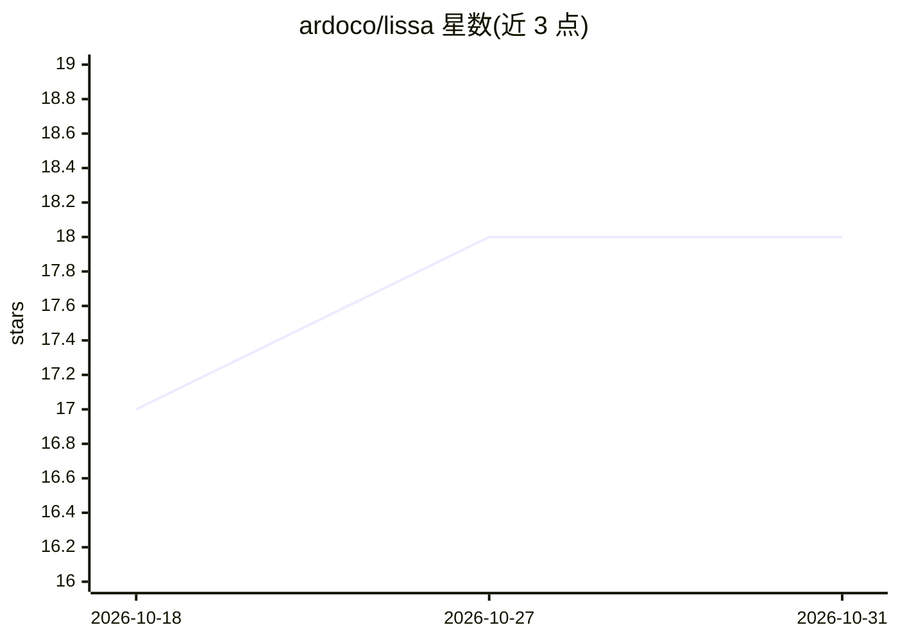

# ardoco/lissa

⭐ 18 · Java · MIT · 推送 2026-10-21 · [GitHub](https://github.com/ardoco/lissa) · [官网](https://ardoco.de/approaches/lissa/) · 组织维护

**用 LLM+RAG 恢复软件制品间追踪链接的框架，面向科研与工程**

LiSSA 是一个基于 Java 的框架，通过 LLM 与检索增强生成（RAG）恢复软件制品间的追踪链接（TLR），覆盖需求到代码、文档到代码、架构文档到架构模型、需求到需求等任务。支持 OpenAI、Open WebUI、Ollama、Blablador、DeepSeek 等语言模型平台，配置 API key 后以 CLI 运行；带请求缓存（可选 Redis）与提示词优化管线，结果输出为 Markdown 与 CSV。需 JDK 21+ 并用 Maven 构建，方法与评估发表于 ICSE 2025 论文。

## 筛选速览

| 维度 | 判定 | 备注 |
|---|---|---|
| AI 角色 | `ai-native` | 本体是模型或模型工具 |
| 许可风险 | `permissive` | MIT |
| 部署形态 | `None` |  |
| 模型依赖 | local-ok | 支持本地模型 |
| 硬件要求 | — | 无带数字的原话,不猜 |
| 安装摩擦 | `medium` | 含编译或系统依赖之一 |
| 成熟度 | — | 结构信号不足 |

## 能力要点

- 跨多种软件制品类型的通用追踪链接恢复（4 类 TLR 任务）
- LLM+RAG 结合，支持 OpenAI/Ollama/DeepSeek/Blablador 等平台
- 请求缓存保证可复现性，含 Redis 集成与提示词优化管线
- 结果以 Markdown 报告与 CSV 链接对形式输出

## 适用场景

- 恢复需求与代码之间的追踪链接用于影响分析
- 一致性检查与维护时定位文档与代码的对应关系
- 科研中复现或对比 RAG-based TLR 方法（ICSE 2025）

## 场景标签

`RAG` `科研工具` · 领域:知识与检索

## 证据(README 行号)

> L6: This framework leverages Large Language Models (LLMs) enhanced through Retrieval-Augmented Generation (RAG) to estab
> L15: LiSSA aims to provide a generic solution for Traceability Link Recovery (TLR) by utilizing LLMs in combination with
> L83: 2. Configure your API keys for the language model platforms you plan to use. Copy the `env-template` file to `.env`

## 星数曲线

2026-10-18 17 → 2026-10-31 18（+1）

---
*卡片 v1 · prompt 1.4 · 生成 2026-10-29 · 置信度 high · 依据 README sha `9244a589e521` · [字段定义](../../DATASET.md)*
