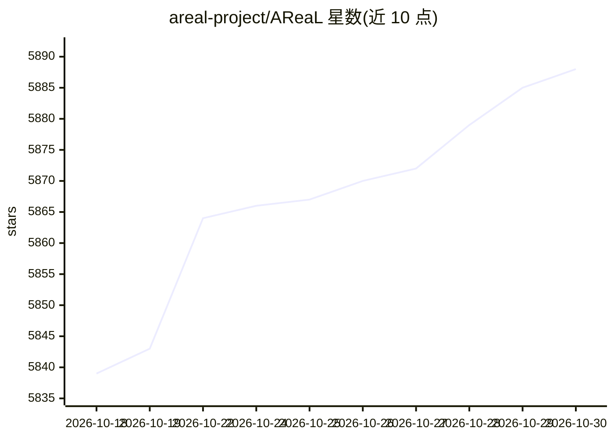

# areal-project/AReaL

⭐ 5,888 · Python · Apache-2.0 · 推送 2026-10-29 · [GitHub](https://github.com/areal-project/AReaL) · [官网](https://areal-ai.io) · 组织维护 · 中文 README

**面向 LLM 与 agent 的大规模异步强化学习训练系统**

AReaL 是连接基础模型训练与 agent 应用的强化学习基础设施，由清华 IIIS 研究者与蚂蚁集团 AReaL 团队开发。核心采用全异步 RL 训练范式，2.0 版本重构为训练、推理、agent、权重更新四类独立服务的微服务架构。支持 GRPO/PPO/DAPO 等十余种算法，训练后端含 Megatron 与 PyTorch FSDP，推理后端支持 vLLM 与 SGLang，模型覆盖 Qwen 系列、Gemma 3 等，并支持华为昇腾 NPU 训练。提供 GSM8K、多轮数学、编码 agent、搜索 agent、VLM 等示例，另发布算法优先的轻量版 AReaL-lite。

## 筛选速览

| 维度 | 判定 | 备注 |
|---|---|---|
| AI 角色 | `ai-ecosystem` | LLM/agent 周边工具 |
| 许可风险 | `permissive` | Apache-2.0 |
| 部署形态 | `library` | 以包/库形式分发 |
| 模型依赖 | local-ok | 支持本地模型 |
| 硬件要求 | — | 无带数字的原话,不猜 |
| 安装摩擦 | `low` | 无编译、无系统依赖或容器化 |
| 成熟度 | — | 结构信号不足 |

## 能力要点

- 全异步 RL 训练范式，2.0 版本为训练/推理/agent/权重更新独立服务的微服务架构
- 支持 GRPO/PPO/DAPO/REINFORCE++ 等 10 余种 RL 算法及同步/异步两种模式
- 训练后端 Megatron / PyTorch FSDP / PyTorch Archon，推理后端 vLLM / SGLang
- 支持 Qwen 系列、Gemma 3 等模型与华为昇腾 NPU 训练

## 适用场景

- 对数学、编码、搜索、客服等推理与 agent 模型做 RL 训练
- 对黑盒 agent 应用做在线 RL 训练（替换 base_url 即可）
- 在 Ray 集群或云端多节点环境做大规模异步训练
- 研究者在轻量版 AReaL-lite 上快速开发 RL 算法

## 场景标签

`强化学习` `模型训练` · 领域:训练与推理

## 证据(README 行号)

> L8: **AReaL** is a reinforcement learning (RL) infrastructure designed to bridge foundation
> L12: Built on a **fully asynchronous RL training paradigm**, AReaL is optimized for
> L36: **\[2026/07/01\]** 🎉 We release **AReaL 2.0**, a major architectural milestone. This

## 星数曲线

2026-10-18 5,839 → 2026-10-30 5,888（+49）

---
*卡片 v1 · prompt 1.4 · 生成 2026-10-20 · 置信度 high · 依据 README sha `77b6bead5100` · [字段定义](../../DATASET.md)*
