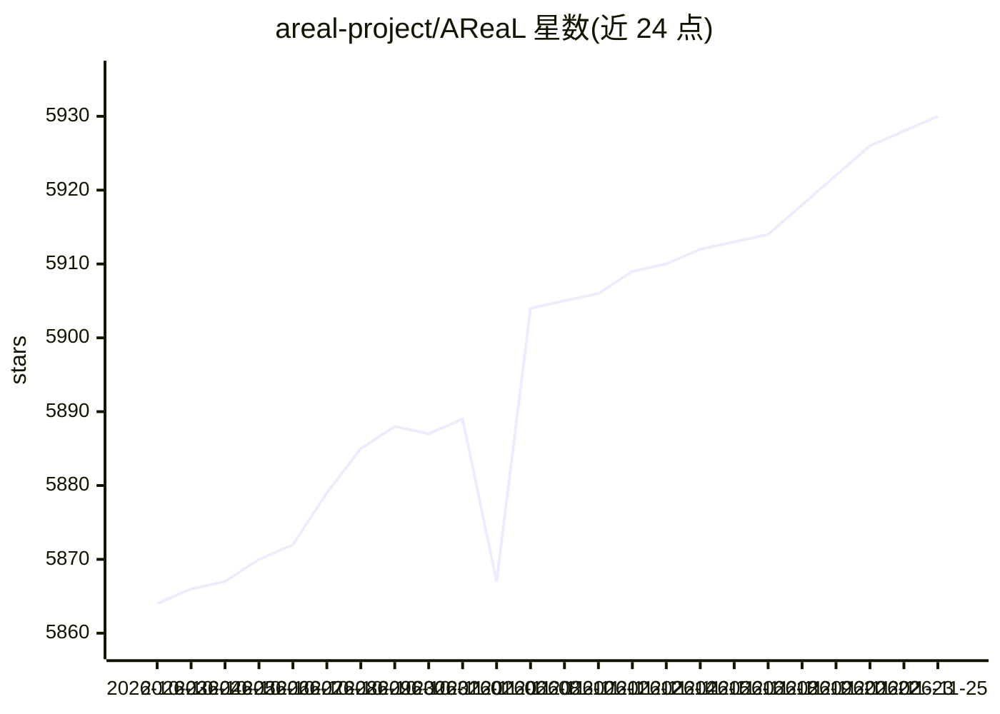

# areal-project/AReaL

⭐ 5,930 · Python · Apache-2.0 · 推送 2026-11-23 · [GitHub](https://github.com/areal-project/AReaL) · [官网](https://areal-ai.io) · 组织维护 · 中文 README

**面向 LLM Agent 应用的强化学习训练基础设施**

AReaL 是一个面向 Agent 应用的异步强化学习训练系统，连接基础模型训练与现代 Agent 应用。采用全异步 RL 训练范式，2.0 版本重构为微服务架构，包含独立的训练、推理、Agent 与权重更新服务。支持 GRPO/PPO/DAPO/DPO 等多种算法，提供数学推理、编码 Agent、客服 Agent、VLM 等示例。训练后端支持 Megatron 与 PyTorch FSDP/Archon，推理后端支持 vLLM 与 SGLang。提供 AReaL-lite 轻量版用于快速原型。支持 Ray 集群与华为昇腾 NPU。

## 筛选速览

| 维度 | 判定 | 备注 |
|---|---|---|
| AI 角色 | `ai-ecosystem` | LLM/agent 周边工具 |
| 许可风险 | `permissive` | Apache-2.0 |
| 部署形态 | `library` | 以包/库形式分发 |
| 模型依赖 | local-ok | 支持本地模型 |
| 硬件要求 | — | 无带数字的原话,不猜 |
| 安装摩擦 | `low` | 无编译、无系统依赖或容器化 |
| 成熟度 | — | 结构信号不足 |

## 能力要点

- 全异步 RL 训练范式，2.0 版采用微服务架构（训练/推理/Agent/权重更新独立服务）
- 内置多种 RL 算法（GRPO、PPO、DAPO、DPO、REINFORCE++ 等）的文档与示例配置
- 训练后端 Megatron/FSDP/Archon，推理后端 vLLM/SGLang
- 通过替换 base_url 即可接入黑盒 Agent 应用，提供 AReaL-lite 轻量版

## 适用场景

- 为数学推理、编码等任务对 LLM 做 RL 后训练
- 在自有 Agent 应用上做在线 RL 训练而无需改代码
- 在 Ray 集群或多节点 GPU 环境训练推理/Agent 模型
- 在华为昇腾 NPU 设备上运行 RL 训练

## 场景标签

`强化学习` `模型训练` · 领域:训练与推理

## 证据(README 行号)

> L8: **AReaL** is a reinforcement learning (RL) infrastructure designed to bridge foundation
> L12: Built on a **fully asynchronous RL training paradigm**, AReaL is optimized for
> L16: AReaL’s mission is to make building AI agents **accessible, efficient, and

## 星数曲线

2026-10-23 5,864 → 2026-11-25 5,930（+66）

---
*卡片 v1 · prompt 1.4 · 生成 2026-11-23 · 置信度 high · 依据 README sha `33de2626f655` · [字段定义](../../DATASET.md)*
