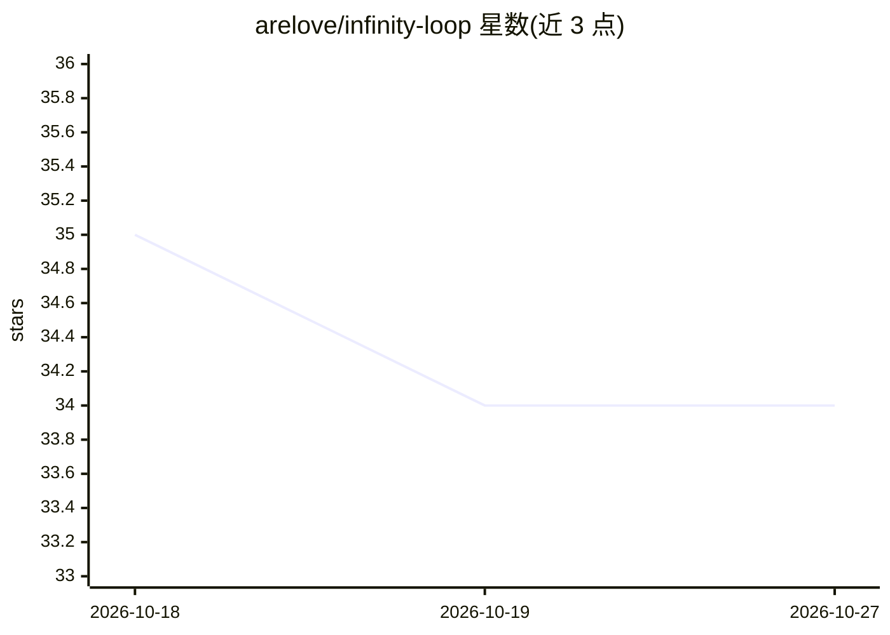

# arelove/infinity-loop

⭐ 34 · Svelte · NOASSERTION · 推送 2026-07-14 · [GitHub](https://github.com/arelove/infinity-loop) · 个人维护

**输入任意主题生成交互式知识图谱的跨平台桌面应用**

基于 Tauri 2 + Svelte 5 + Rust 的桌面应用：用户输入一个概念，由所选 AI 提供商结合 Tavily 网络搜索生成节点与连接构成的实时知识图谱，含来源与图片。提供 Seek（AI 搜索）与 Dev（代码库架构分析）两种模式，Dev 模式的 PDF 结构分析指定使用 Gemini。支持 Gemini、OpenAI、Anthropic、xAI、NVIDIA NIM 及本地 Ollama 等提供商，API key 由 Rust 后端存储，不暴露给前端 webview。Windows/macOS/Linux 提供预编译安装包，也可从源码构建。

## 筛选速览

| 维度 | 判定 | 备注 |
|---|---|---|
| AI 角色 | `ai-native` | 本体是模型或模型工具 |
| 许可风险 | `permissive` | NOASSERTION |
| 部署形态 | `desktop` | 安装包/桌面程序 |
| 模型依赖 | local-ok | 支持本地模型 |
| 硬件要求 | — | 无带数字的原话,不猜 |
| 安装摩擦 | `low` | 无编译、无系统依赖或容器化 |
| 成熟度 | — | 结构信号不足 |

## 能力要点

- 多 AI 提供商可选（Gemini/OpenAI/Anthropic/xAI/NIM/Ollama）+ Tavily 网络搜索生成知识图谱
- Dev 模式加载代码库并生成架构图
- API key 存于 Rust 后端，不暴露给 webview
- 三平台预编译安装包，支持英文与俄文

## 适用场景

- 探索任意概念并可视化其关联知识与来源
- 加载自己的代码库生成架构地图
- 本地 Ollama 模型无需 API key 即可生成图谱

## 场景标签

`知识图谱` · 领域:知识与检索

## 证据(README 行号)

> L6: Type any topic and get an interactive knowledge graph of connected concepts, sources, and ideas, generated by the AI
> L24: Infinity Loop is a cross-platform desktop application for visual knowledge exploration. You enter a concept — "quan
> L28: - **Seek** — AI search mode. Ask a question, and your chosen AI provider together with Tavily build the graph.

## 星数曲线

2026-10-18 35 → 2026-10-27 34（-1）

---
*卡片 v1 · prompt 1.4 · 生成 2026-10-25 · 置信度 high · 依据 README sha `b11cb99a32f1` · [字段定义](../../DATASET.md)*
