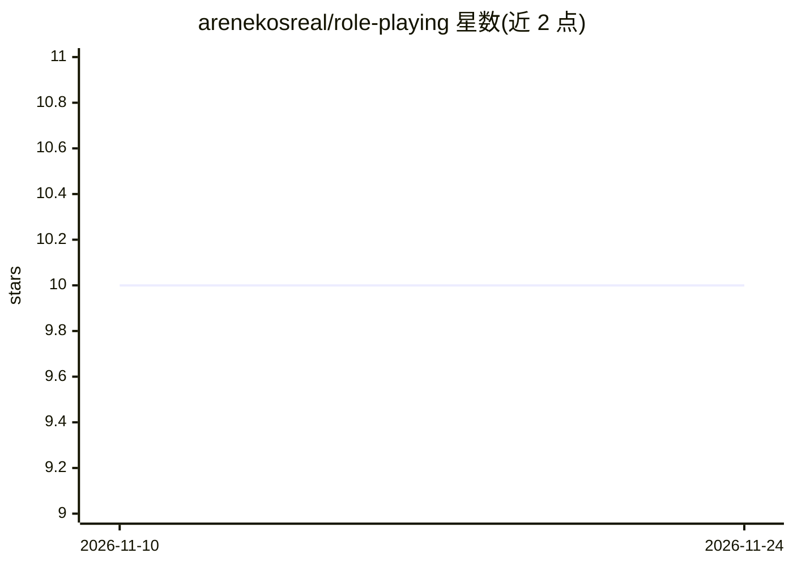

# arenekosreal/role-playing

⭐ 10 · WTFPL · 推送 2025-12-25 · [GitHub](https://github.com/arenekosreal/role-playing) · 个人维护

**为 LLM 角色扮演提供系统提示词的资料集**

收录用于模型角色扮演的系统提示词及配套资料的仓库。按模型、语言、角色组织提示词文件，README 给出六步使用流程：选择并从 Hugging Face 下载 GGUF 模型，选定语言与角色后获取对应的 Markdown 系统提示词（强调使用 raw 内容而非渲染页面），再通过 llama.cpp、ollama 等本地工具将系统提示词设置给模型。声明与 SillyTavern 角色卡不兼容，内容包含 NSFW 需自行承担风险。

## 筛选速览

| 维度 | 判定 | 备注 |
|---|---|---|
| AI 角色 | `ai-knowledge` | 知识聚合/清单类 |
| 许可风险 | `viral` | WTFPL |
| 部署形态 | `None` |  |
| 模型依赖 | — | README 未给出锁定关系 |
| 硬件要求 | — | 无带数字的原话,不猜 |
| 安装摩擦 | `low` | 无编译、无系统依赖或容器化 |
| 成熟度 | — | 结构信号不足 |

## 能力要点

- 按 模型/语言/角色 路径组织的系统提示词文件集合
- 提供 GGUF 格式角色扮演模型的使用示例
- 支持通过 llama.cpp、ollama 等本地工具设置提示词
- 注明不兼容 SillyTavern 角色卡格式

## 适用场景

- 为本地运行的角色扮演模型配置系统提示词
- 查找特定角色/语言的角色扮演提示词
- 用 llama.cpp/ollama 加载 GGUF 角色扮演模型

## 场景标签

`提示工程` · 领域:Agent 开发

## 证据(README 行号)

> L9: System prompts and other stuff for role-playing with models.
> L31:  It should be placed at `./huggingface.co/mradermacher/Peach-2.0-9B-8k-Roleplay-i1-GGUF/zh-cn/Vanilla-Maid.md`.

## 星数曲线

2026-11-10 10 → 2026-11-24 10（+0）

---
*卡片 v1 · prompt 1.4 · 生成 2026-11-20 · 置信度 high · 依据 README sha `6335e28608f3` · [字段定义](../../DATASET.md)*
