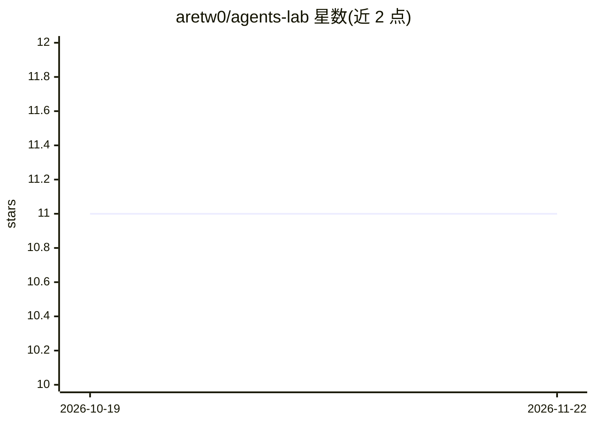

# aretw0/agents-lab

⭐ 11 · TypeScript · MIT · 推送 2026-06-24 · [GitHub](https://github.com/aretw0/agents-lab) · [官网](https://aretw0.github.io/agents-lab/) · 个人维护

**面向 Pi 生态开发者的本地 agent 技能与扩展策划栈**

本地优先的实验室仓库，用于策划、测试和分发可复用的 AI agent 原语，当前聚焦 Pi 生态。通过 npx 安装 @aretw0/pi-stack，提供 git/web/Pi 开发等 first-party skills、带 guardrails/配额可见性/审计的扩展，以及经筛选的第三方包列表，按 strict-curated 等安装配置文件分发；开发用 pnpm，含本地 CI 校验与 GitHub Pages 文档站。

## 筛选速览

| 维度 | 判定 | 备注 |
|---|---|---|
| AI 角色 | `ai-ecosystem` | LLM/agent 周边工具 |
| 许可风险 | `permissive` | MIT |
| 部署形态 | `library` | 以包/库形式分发 |
| 模型依赖 | — | README 未给出锁定关系 |
| 硬件要求 | — | 无带数字的原话,不猜 |
| 安装摩擦 | `low` | 无编译、无系统依赖或容器化 |
| 成熟度 | — | 结构信号不足 |

## 能力要点

- npx @aretw0/pi-stack 多配置文件安装（默认 strict-curated）
- first-party skills 覆盖 git、web（含本地 CDP）、Pi 开发与策划
- 扩展提供 guardrails、诊断、配额可见性、上下文 watchdog 与栈审计
- 第三方包经过滤安装，冲突由 installer 过滤并用测试覆盖

## 适用场景

- 为 Pi coding agent 安装一套策划好的 skills 与扩展
- 在本地实验 agent 的委派与长时运行自动化
- 开发并发布自己的 Pi skills/扩展

## 场景标签

`编码 Agent` `精选清单` · 领域:编码与开发

## 证据(README 行号)

> L3: Laboratório local-first para curar, testar e distribuir primitivas reutilizáveis para agentes de IA, com foco atual 
> L9: - `@aretw0/pi-stack`: stack curada para Pi, instalada por `npx @aretw0/pi-stack`.
> L11: - Extensões first-party com guardrails, diagnóstico, quota visibility, context watchdog, board/project surfaces e a

## 星数曲线

2026-10-19 11 → 2026-11-22 11（+0）

---
*卡片 v1 · prompt 1.4 · 生成 2026-11-18 · 置信度 high · 依据 README sha `e17f277b0f19` · [字段定义](../../DATASET.md)*
