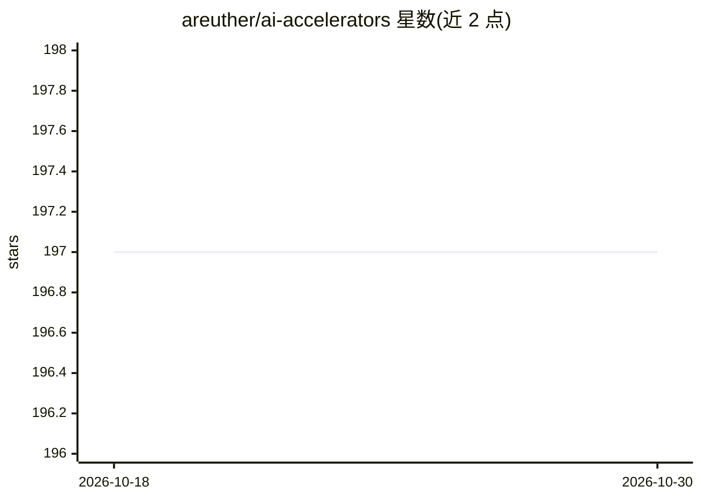

# areuther/ai-accelerators

⭐ 197 · 推送 2025-11-24 · [GitHub](https://github.com/areuther/ai-accelerators) · 组织维护

**AI/ML 加速器系列调研论文的开放数据集仓库**

由 MIT 林肯实验室超级计算中心（LLSC）团队维护，收录其 2019-2025 年间在 IEEE HPEC 会议发表的七篇 AI/ML 加速器调研论文（含 Lincoln AI Computing Survey 系列）及配套编译的开放数据集。数据以 CSV 表格等子页面形式提供，覆盖从计算性能视角对训练与推理加速器的跟踪调查。要求使用者引用论文致谢，版权归 MIT 与作者。

## 筛选速览

| 维度 | 判定 | 备注 |
|---|---|---|
| AI 角色 | `ai-knowledge` | 知识聚合/清单类 |
| 许可风险 | `none` | — |
| 部署形态 | `None` |  |
| 模型依赖 | — | README 未给出锁定关系 |
| 硬件要求 | — | 无带数字的原话,不猜 |
| 安装摩擦 | `low` | 无编译、无系统依赖或容器化 |
| 成熟度 | — | 结构信号不足 |

## 能力要点

- 配套 2019-2025 年七篇 IEEE HPEC 调研论文的数据集
- 以 CSV 等子页面形式提供开放数据
- 从计算性能视角跟踪 AI/ML 加速器发展

## 适用场景

- 查找 AI/ML 加速器硬件的历史规格与性能数据
- 为加速器研究引用配套的调研论文与数据集

## 场景标签

`精选清单` `科研工具` · 领域:学习与行业

## 证据(README 行号)

> L6: A few colleagues and I at MIT Lincoln Laboratory Supercomputing Center (LLSC) have been closely following, studying,
> L10: So far we have published five papers at the IEEE-HPEC Conference. Each of the papers are available in IEEE Xplore a

## 星数曲线

2026-10-18 197 → 2026-10-30 197（+0）

---
*卡片 v1 · prompt 1.4 · 生成 2026-10-22 · 置信度 high · 依据 README sha `64a1bff8532c` · [字段定义](../../DATASET.md)*
