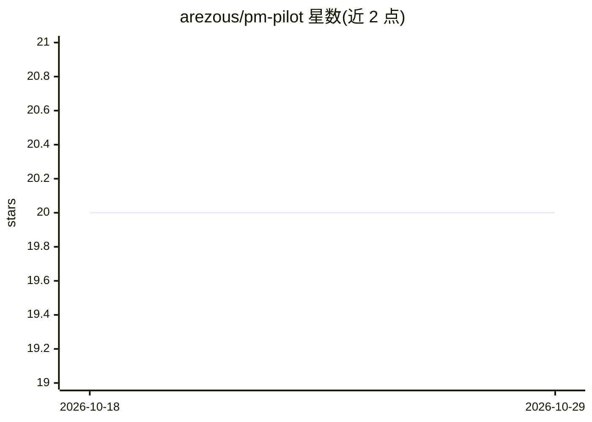

# arezous/pm-pilot

⭐ 20 · MIT · 推送 2026-04-12 · [GitHub](https://github.com/arezous/pm-pilot) · 个人维护

**面向产品经理的 AI 副驾驶：12 个技能命令产出 PRD 等结构化文档**

为产品经理、产品负责人打造的 AI 工作系统，需在 Claude Code、Cursor 或 Codex 中运行。以 12 个斜杠命令提供 PRD 撰写、竞品分析、访谈主题归纳、反馈分诊、优先级排序等技能；维护 company/competitors/personas/product 四个本地上下文文件供技能读取，使输出与用户实际产品语境关联。上下文文件 gitignore 保持在本地。无依赖、无安装、无 API key，通过 git clone 获取。

## 筛选速览

| 维度 | 判定 | 备注 |
|---|---|---|
| AI 角色 | `ai-native` | 本体是模型或模型工具 |
| 许可风险 | `permissive` | MIT |
| 部署形态 | `None` |  |
| 模型依赖 | — | README 未给出锁定关系 |
| 硬件要求 | — | 无带数字的原话,不猜 |
| 安装摩擦 | `low` | 无编译、无系统依赖或容器化 |
| 成熟度 | `idea` | |

## 能力要点

- 12 个 PM 技能命令（/prd、/analyze-competitors、/prioritize 等）
- 本地上下文系统（company/competitors/personas/product 四文件）随使用积累
- 三种输入方式：粘贴内容、文件路径、引用工作区文件
- 无依赖、无安装、无 API key

## 适用场景

- 用 /prd 生成基于自家产品语境的 PRD 或项目简报
- 把用户访谈笔记归纳为主题与建议（/synthesize-interviews）
- 对客户反馈做分类、排序与流转（/triage-feedback）
- 按公司上下文对功能打分决定构建优先级

## 场景标签

`AI 写作` `AI 助手` · 领域:对话与助手

## 证据(README 行号)

> L3: Your AI-powered copilot for modern product management. Built for Claude Code, Cursor, and Codex.
> L12: - **Skills, not prompts.** Instead of crafting the right prompt every time, you run `/prd` or `/analyze-competitors
> L49: |Command|What it does|

## 星数曲线

2026-10-18 20 → 2026-10-29 20（+0）

---
*卡片 v1 · prompt 1.4 · 生成 2026-10-28 · 置信度 high · 依据 README sha `7a0d2800f6fb` · [字段定义](../../DATASET.md)*
