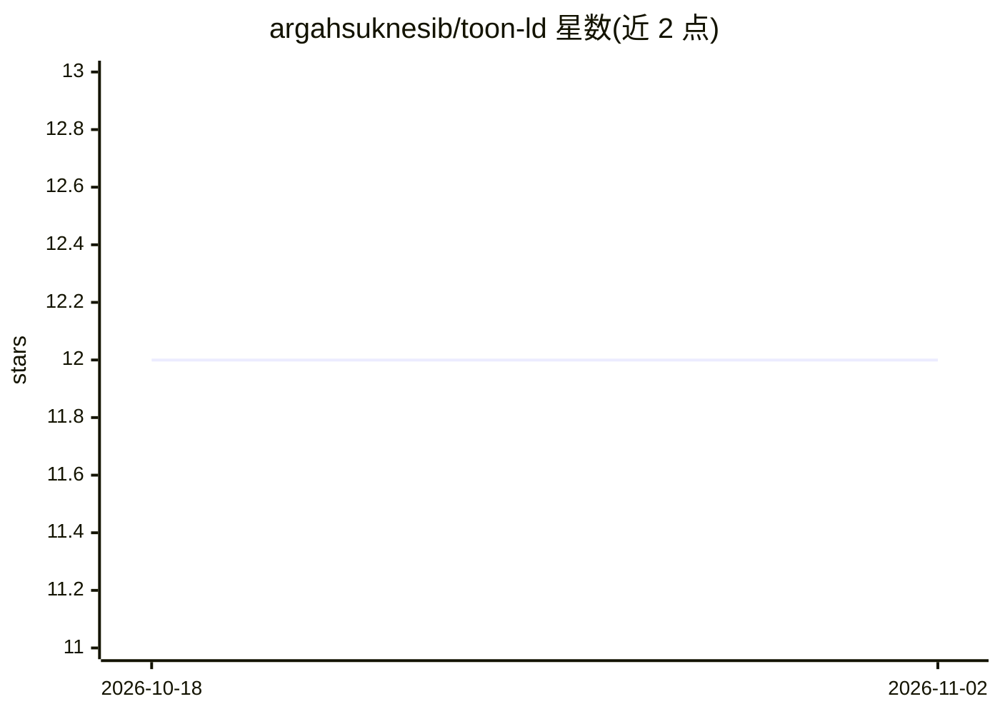

# argahsuknesib/toon-ld

⭐ 12 · Rust · MIT · 推送 2026-09-07 · [GitHub](https://github.com/argahsuknesib/toon-ld) · 个人维护

**面向 LLM 上下文窗口的知识图谱压缩序列化格式（TOON-LD）**

TOON-LD 是在 TOON 语法上扩展 Linked Data 语义的序列化格式，定位为 JSON-LD 的无损压缩层：通过表格式数组（共享表头的 CSV 风格行）消除重复键，README 基准显示较 JSON-LD 节省约 40-60% token。支持全部 JSON-LD 1.1 关键词（@context/@graph/@id/@type 等）并支持往返转换；每个 TOON-LD 文档同时也是合法 TOON 文档。面向 RAG/知识图谱开发者在 LLM 上下文中塞入更多结构化数据，提供 Rust 核心、CLI、WebAssembly（npm）与 Python（PyPI）四种实现。

## 筛选速览

| 维度 | 判定 | 备注 |
|---|---|---|
| AI 角色 | `ai-ecosystem` | LLM/agent 周边工具 |
| 许可风险 | `permissive` | MIT |
| 部署形态 | `library` | 以包/库形式分发 |
| 模型依赖 | — | README 未给出锁定关系 |
| 硬件要求 | — | 无带数字的原话,不猜 |
| 安装摩擦 | `medium` | 含编译或系统依赖之一 |
| 成熟度 | — | 结构信号不足 |

## 能力要点

- README 基准较 JSON-LD 节省约 40-60% token
- 支持全部 JSON-LD 1.1 关键词与无损往返转换
- 表格式数组以共享表头消除重复键
- 提供 Rust/CLI/WASM/Python 四种实现

## 适用场景

- RAG 流水线中压缩知识图谱以降低 token 成本
- 在有限上下文窗口中放入更多结构化数据
- 在 JSON-LD 工具链与 LLM 输入格式间做转换

## 场景标签

`知识图谱` `RAG` · 领域:知识与检索

## 证据(README 行号)

> L7: **Token-Oriented Object Notation for Linked Data** — A lossless **Knowledge Graph Compression** format for LLM Conte
> L9: TOON-LD reduces token usage by **40-60%** compared to JSON-LD, allowing you to fit twice as much structured data int
> L17: **The Solution:** TOON-LD acts as a compression layer. It combines the semantic expressiveness of RDF with radical 

## 星数曲线

2026-10-18 12 → 2026-11-02 12（+0）

---
*卡片 v1 · prompt 1.4 · 生成 2026-11-01 · 置信度 high · 依据 README sha `29e7744196b9` · [字段定义](../../DATASET.md)*
