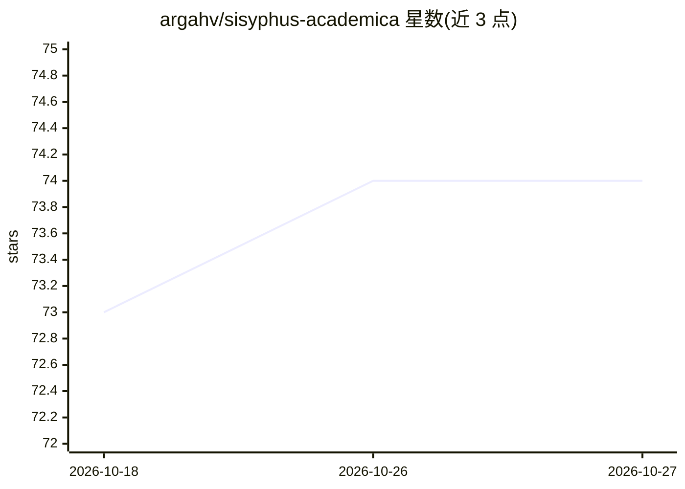

# argahv/sisyphus-academica

⭐ 74 · Python · MIT · 推送 2026-10-10 · [GitHub](https://github.com/argahv/sisyphus-academica) · [官网](https://argahv.github.io/sisyphus-academica/) · 个人维护

**多 agent 科研论文生成管道：文献综述、新颖性生成与引用验证**

由 20+ 专业化 agent 组成的科研论文生成管道：Research Director 编排，5 个并行 scout 调研文献，6 个新颖性引擎生成假设，10 个对抗性审稿人 persona 并行评审，最终经 5 道代码强制质量门（引用经 Semantic Scholar/CrossRef/OpenAlex/arXiv 双源核验、统计重算、41 种 AI 写作模式检测、风格审计、全员评审通过）后构建 LaTeX PDF。依赖 OpenCode 或兼容 agent 平台，provider 无关（OpenAI 兼容或 Anthropic API）；sisyphus CLI 可独立运行，17 个技能包可经 npx 安装到任意读取 SKILL.md 的 agent。

## 筛选速览

| 维度 | 判定 | 备注 |
|---|---|---|
| AI 角色 | `ai-native` | 本体是模型或模型工具 |
| 许可风险 | `permissive` | MIT |
| 部署形态 | `library` | 以包/库形式分发 |
| 模型依赖 | locked-api |  |
| 硬件要求 | — | 无带数字的原话,不猜 |
| 安装摩擦 | `low` | 无编译、无系统依赖或容器化 |
| 成熟度 | — | 结构信号不足 |

## 能力要点

- 6 个新颖性引擎 + 10 个对抗性审稿人 + 20+ 专业化 agent
- 5 道代码强制质量门，含引用双源核验与 p 值重算
- 17 个可移植 agent 技能，兼容 Claude Code/Codex/Cursor 等
- sisyphus CLI 独立运行，仅依赖 Python 3.10+ 标准库

## 适用场景

- 端到端生成含已验证引用的 LaTeX 论文
- 为现有 agent 安装新颖性生成或对抗性评审技能
- 校验已有论文草稿的引用、统计与 AI 写作模式

## 场景标签

`多智能体` `科研工具` `AI 写作` · 领域:Agent 开发

## 证据(README 行号)

> L13: Not a writing assistant. Not a chatbot with a LaTeX plugin. A **self-coordinating swarm** of 20+ specialized agents
> L45: The novelty engines and reviewer personas are packaged as **standalone agent skills** — drop them into any agent th

## 星数曲线

2026-10-18 73 → 2026-10-27 74（+1）

---
*卡片 v1 · prompt 1.4 · 生成 2026-10-24 · 置信度 mid · 依据 README sha `e7f91b8accc9` · [字段定义](../../DATASET.md)*
