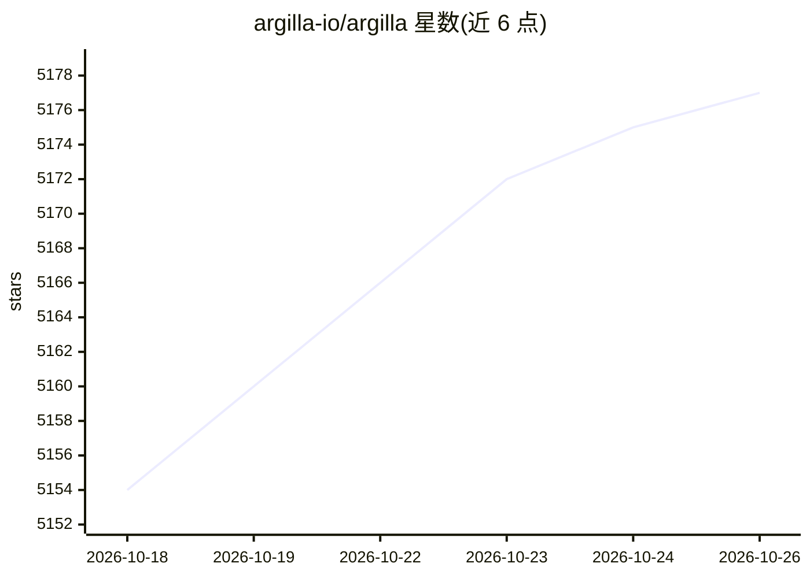

# argilla-io/argilla

⭐ 5,177 · Python · Apache-2.0 · 推送 2026-10-19 · [GitHub](https://github.com/argilla-io/argilla) · [官网](https://argilla-io.github.io/argilla/latest/) · 组织维护

**面向 AI 工程师与领域专家的高质量数据集协作标注平台**

用于为 AI 项目构建高质量数据集的协作工具：支持传统 NLP（文本分类、NER）、LLM（RAG、偏好调优）与多模态项目的数据收集与人工反馈标注。提供 Python SDK（pip 安装）与服务端部署（支持 Hugging Face Spaces 一键部署），UI 提供过滤器、AI 反馈建议与语义搜索以加速标注，可编程式构建持续评估与模型改进工作流。注意：原维护者已离开，代码库进入维护模式，不再新增功能，仅修复缺陷与发布补丁，并公开征集新维护者。

## 筛选速览

| 维度 | 判定 | 备注 |
|---|---|---|
| AI 角色 | `ai-ecosystem` | LLM/agent 周边工具 |
| 许可风险 | `permissive` | Apache-2.0 |
| 部署形态 | `library` | 以包/库形式分发 |
| 模型依赖 | — | README 未给出锁定关系 |
| 硬件要求 | — | 无带数字的原话,不猜 |
| 安装摩擦 | `low` | 无编译、无系统依赖或容器化 |
| 成熟度 | — | 结构信号不足 |

## 能力要点

- 文本分类、NER、RAG、偏好调优、多模态等项目的数据收集与人工反馈
- UI 标注辅助：过滤器、AI 反馈建议、语义搜索
- Python SDK + Argilla Server 架构，支持 Hugging Face Spaces 免费部署
- 可编程工作流支持持续评估与模型改进

## 适用场景

- 为 LLM 微调与偏好调优构建标注数据集
- 领域专家与 AI 工程师协作完成数据标注与人工反馈收集
- 对现有数据集做清洗与质量问题排查

## 场景标签

`MLOps` · 领域:训练与推理

## 证据(README 行号)

> L33: Argilla is a collaboration tool for AI engineers and domain experts who need to build high-quality datasets for the
> L45: Argilla can be used for collecting human feedback for a wide variety of AI projects like traditional NLP (text clas

## 星数曲线

2026-10-18 5,154 → 2026-10-26 5,177（+23）

---
*卡片 v1 · prompt 1.4 · 生成 2026-10-20 · 置信度 high · 依据 README sha `3e407ab60039` · [字段定义](../../DATASET.md)*
