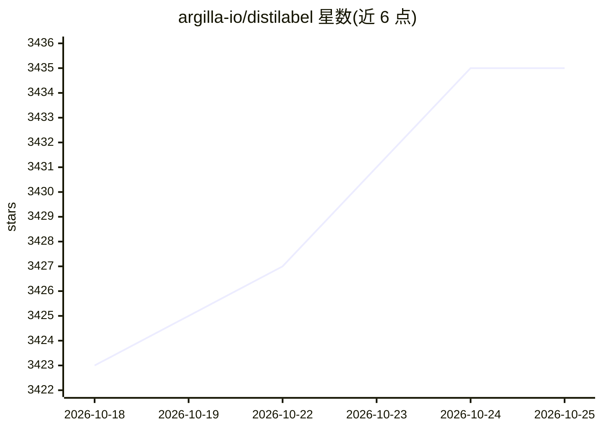

# argilla-io/distilabel

⭐ 3,436 · Python · Apache-2.0 · 推送 2026-10-19 · [GitHub](https://github.com/argilla-io/distilabel) · [官网](https://distilabel.argilla.io) · 组织维护

**面向工程师的合成数据与 AI 反馈流水线框架**

由 Argilla 团队开发的 Python 框架，用于构建合成数据生成与 AI 反馈（AIF）流水线，方法基于已验证的研究论文。通过统一 API 接入多家 LLM 提供商（Anthropic、Cohere、Groq、Ollama、vLLM、OpenAI、Vertex AI 等），支持结构化生成（outlines/instructor）、Ray 分布式扩展、文本聚类与去重等数据处理扩展。社区曾用它生成 OpenHermesPreference 等百万级偏好数据集。原始作者已离开项目，现由社区协作者维护，需 Python 3.9+。

## 筛选速览

| 维度 | 判定 | 备注 |
|---|---|---|
| AI 角色 | `ai-ecosystem` | LLM/agent 周边工具 |
| 许可风险 | `permissive` | Apache-2.0 |
| 部署形态 | `library` | 以包/库形式分发 |
| 模型依赖 | local-ok | 支持本地模型 |
| 硬件要求 | — | 无带数字的原话,不猜 |
| 安装摩擦 | `low` | 无编译、无系统依赖或容器化 |
| 成熟度 | — | 结构信号不足 |

## 能力要点

- 基于已验证研究论文的合成数据生成与 AI 反馈流水线
- 统一 API 接入 15+ LLM 提供商（含 Ollama、vLLM、llama.cpp）
- 支持 outlines/instructor 结构化生成
- Ray 分布式扩展、faiss 嵌入、minhash 去重等数据处理扩展

## 适用场景

- 为指令遵循、偏好对齐（RLHF/RLAIF/DPO）合成训练数据
- 用 AI 反馈对现有数据集打分与过滤
- 大规模生成带质量控制的合成数据集

## 场景标签

`强化学习` · 领域:训练与推理

## 证据(README 行号)

> L26: Distilabel is the framework for synthetic data and AI feedback for engineers who need fast, reliable and scalable p
> L32: Distilabel can be used for generating synthetic data and AI feedback for a wide variety of projects including tradi

## 星数曲线

2026-10-18 3,423 → 2026-10-25 3,435（+12）

---
*卡片 v1 · prompt 1.4 · 生成 2026-10-20 · 置信度 high · 依据 README sha `3e46dbd7113c` · [字段定义](../../DATASET.md)*
