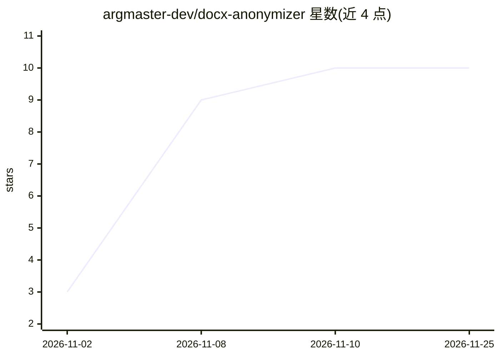

# argmaster-dev/docx-anonymizer

⭐ 10 · JavaScript · Apache-2.0 · 推送 2026-11-07 · [GitHub](https://github.com/argmaster-dev/docx-anonymizer) · [官网](https://github.com/argmaster-dev/docx-anonymizer/releases/latest) · 个人维护

**给需要向 AI 聊天上传文档的员工：本地匿名化个人与公司敏感信息后再发送**

该 Chrome/Edge 浏览器扩展在用户向 ChatGPT、Claude 或其他 AI 聊天界面附加文件时进行拦截，在本地检测个人数据（姓名、护照、电话、银行账号、税号）和公司标识符，用占位符替换后仅上传已脱敏的副本。恢复密钥（替换映射表）保留在用户计算机上，可用于通过“恢复文本”页面还原 AI 的回复。它支持 Word、Excel、PowerPoint、PDF（带文本层）和文本格式，保留格式和元数据擦除，所有处理均在浏览器中本地进行且无网络请求。覆盖范围限制：不检查在聊天框中输入或粘贴的文本、通过拖拽绕过文件按钮的上传、桌面/移动聊天应用、未授权站点及不受支持的格式（图片、压缩包、.doc、.rtf）。

## 筛选速览

| 维度 | 判定 | 备注 |
|---|---|---|
| AI 角色 | `ai-enhanced` | 去掉 AI 部分产品仍成立 |
| 许可风险 | `permissive` | Apache-2.0 |
| 部署形态 | `library` | 以包/库形式分发 |
| 模型依赖 | — | README 未给出锁定关系 |
| 硬件要求 | — | 无带数字的原话,不猜 |
| 安装摩擦 | `low` | 无编译、无系统依赖或容器化 |
| 成熟度 | — | 结构信号不足 |

## 能力要点

- 将文档上传拦截至 AI 聊天，并在本地替换 PII/公司标识符为占位符
- 通过本地存储、可选密码保护的恢复密钥还原 AI 回复
- 3 个组内覆盖 50 个检测类别，支持校验和/格式验证，支持自定义词典和正则
- 所有处理均在浏览器本地进行，无网络请求

## 适用场景

- 在向 ChatGPT 或 Claude 发送合同/电子表格前对员工个人数据进行脱敏
- 避免根据 152-FZ 向国外 AI 服务传输个人数据
- 与同事安全地共享包含客户名称和合同编号的敏感商业信息

## 场景标签

`文档解析` `网络安全` · 领域:知识与检索

## 证据(README 行号)

> L28: Расширение для Chrome и Edge: перед тем как договор, таблица или презентация попадёт в ChatGPT, Claude или другой И
> L5: **Что это.** Сторож между сотрудником и чатом с ИИ. Расширение встроено в саму отправку файла: когда человек прикреп
> L46: **What is masked (0.4, extended in 0.5).** 50 categories with checksum or format validation where one exists, in th

## 星数曲线

2026-11-02 3 → 2026-11-25 10（+7）

---
*卡片 v1 · prompt 1.4 · 生成 2026-11-20 · 置信度 mid · 依据 README sha `4efe3bbd1f73` · [字段定义](../../DATASET.md)*
