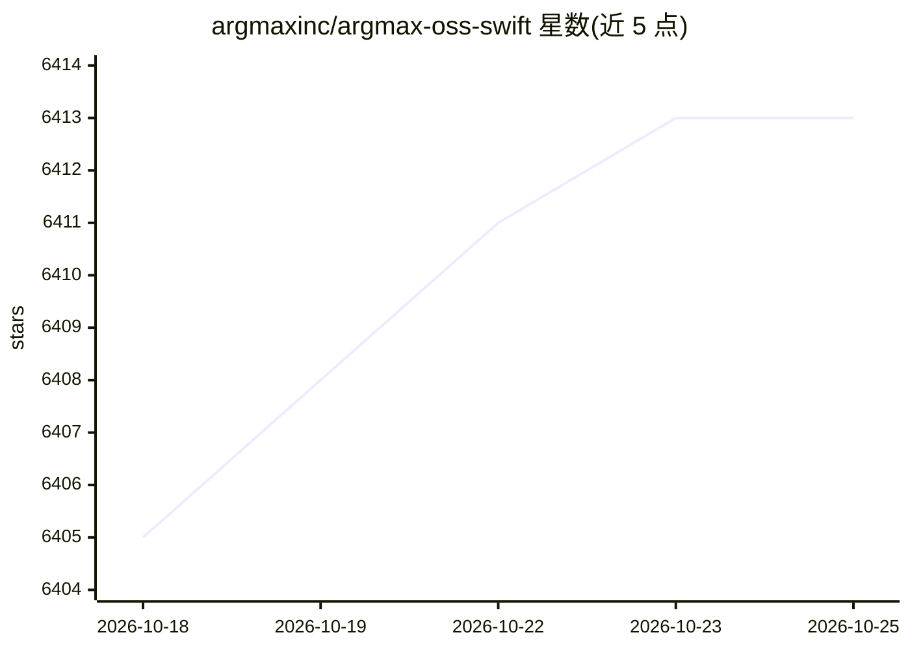

# argmaxinc/argmax-oss-swift

⭐ 6,413 · Swift · MIT · 推送 2026-10-11 · [GitHub](https://github.com/argmaxinc/argmax-oss-swift) · 组织维护

**Apple 芯片端侧语音 AI SDK：语音识别、说话人分离与语音合成**

Argmax 公司维护的 Swift 端侧推理框架集合，包含三个库产品：WhisperKit（基于 OpenAI Whisper 的语音转文字，支持增量流式加载、多模型变体选择与自定义微调 CoreML 模型）、SpeakerKit（基于 Pyannote 的说话人分离）、TTSKit（基于 Qwen3-TTS 的文字转语音，9 种内置音色、10 种语言、实时流式播放）。附带 Swift CLI 工具与实现 OpenAI Audio API 兼容接口的本地服务器。要求 macOS 14+/Xcode 16+，TTSKit 要求 macOS 15+ 或 iOS 18+。另提及收费的 Argmax Pro SDK 提供额外功能。

## 筛选速览

| 维度 | 判定 | 备注 |
|---|---|---|
| AI 角色 | `ai-native` | 本体是模型或模型工具 |
| 许可风险 | `permissive` | MIT |
| 部署形态 | `None` |  |
| 模型依赖 | — | README 未给出锁定关系 |
| 硬件要求 | — | 无带数字的原话,不猜 |
| 安装摩擦 | `low` | 无编译、无系统依赖或容器化 |
| 成熟度 | — | 结构信号不足 |

## 能力要点

- WhisperKit 语音转文字，支持大文件增量流式加载与 VAD 分块
- TTSKit 运行 Qwen3-TTS（0.6B/1.7B），9 种音色、10 种语言、逐帧流式播放
- 本地服务器实现 OpenAI Audio API，支持 SSE 流式输出与词级时间戳
- whisperkittools 支持生成并部署自定义微调 Whisper CoreML 模型

## 适用场景

- 在 iOS/macOS 应用中集成端侧语音转文字
- 离线运行文字转语音并实时播放
- 通过 OpenAI SDK 客户端调用本地语音转录服务器

## 场景标签

`语音识别` `语音合成` · 领域:内容生成

## 证据(README 行号)

> L18: Argmax Open-Source SDK Swift is a collection of turn-key on-device inference frameworks:
> L19: - **WhisperKit** for speech-to-text with OpenAI Whisper
> L20: - **SpeakerKit** for speaker diarization with Pyannote
> L21: - **TTSKit** for text-to-speech with Qwen-TTS

## 星数曲线

2026-10-18 6,405 → 2026-10-25 6,413（+8）

---
*卡片 v1 · prompt 1.4 · 生成 2026-10-20 · 置信度 high · 依据 README sha `b58969ea8ad2` · [字段定义](../../DATASET.md)*
