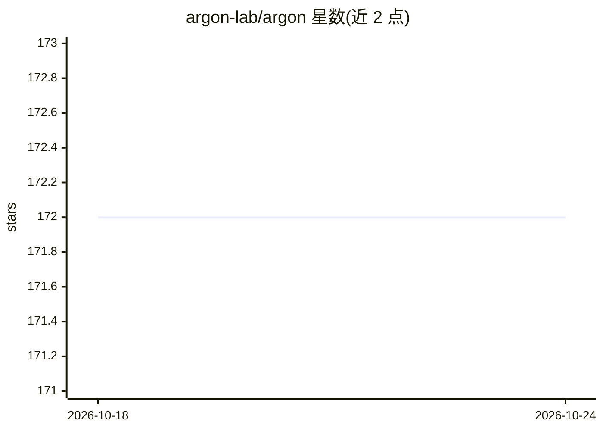

# argon-lab/argon

⭐ 176 · Go · MIT · 推送 2026-10-19 · [GitHub](https://github.com/argon-lab/argon) · [官网](https://www.argonlabs.tech) · 组织维护

**面向 AI agent 的 MongoDB 分支/时间旅行/撤销版本控制工具**

用 Go 实现的 MongoDB 数据版本控制层：分支仅为元数据写入（零拷贝），checkout 将分支物化为真实数据库，任意驱动（pymongo/mongoose/mongosh）均可连接；通过 change stream 捕获文档写入形成历史，支持时间旅行查询、按 actor 撤销、三方合并（数据 PR）、TTL 沙箱与状态 pin。面向运行 AI agent 的开发者，提供 MCP 服务器（13 个工具）、Python SDK 与 LangGraph 适配器，以及本地 Web 控制台（UI+REST）。限制：索引与集合选项不做版本化，保留策略采用快照+GC 窗口而非永久保存所有写入。

## 筛选速览

| 维度 | 判定 | 备注 |
|---|---|---|
| AI 角色 | `ai-ecosystem` | LLM/agent 周边工具 |
| 许可风险 | `permissive` | MIT |
| 部署形态 | `library` | 以包/库形式分发 |
| 模型依赖 | — | README 未给出锁定关系 |
| 硬件要求 | — | 无带数字的原话,不猜 |
| 安装摩擦 | `low` | 无编译、无系统依赖或容器化 |
| 成熟度 | — | 结构信号不足 |

## 能力要点

- 分支为元数据写入，checkout 物化为真实 mongod 数据库
- 文档级写入捕获，支持时间旅行查询、按 actor 撤销与三方合并
- TTL 沙箱与数据 pin，作为一次性 agent 工作区
- MCP 服务器（13 工具）+ Python SDK + LangGraph checkpoint saver

## 适用场景

- AI agent 在生产数据分支上实验后可整体撤销会话
- 以数据 PR 形式评审合并 agent 产生的数据变更
- 查询或回滚数据库在历史时间点的文档状态

## 场景标签

`Agent 记忆` · 领域:Agent 开发

## 证据(README 行号)

> L4:  Argon — Git for MongoDB, built for AI agents: branch off prod, run an agent, undo the session
> L92: ```bash
> L93: claude mcp add argon -- argon mcp        # 13 tools: sandbox, diff, merge, undo, pins

## 星数曲线



2026-10-18 172 → 2026-10-24 172（+0）


---
*卡片 v1 · prompt 1.4 · 生成 2026-10-23 · 置信度 high · 依据 README sha `69bbaf4d7df7` · [字段定义](../../DATASET.md)*
