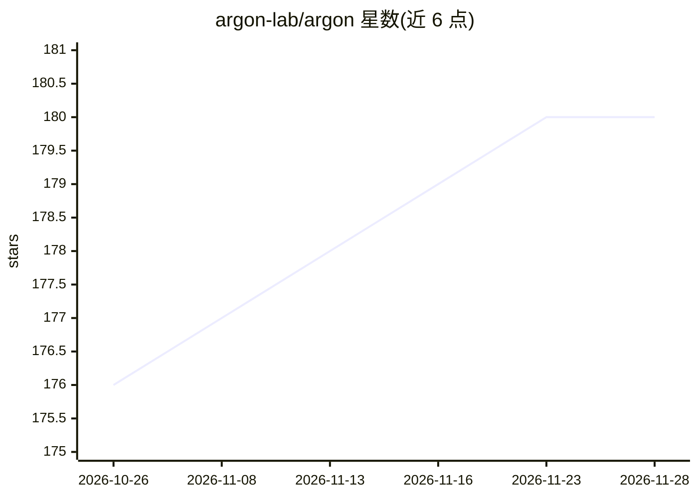

# argon-lab/argon

⭐ 180 · Go · MIT · 推送 2026-11-23 · [GitHub](https://github.com/argon-lab/argon) · [官网](https://argonlabs.tech) · 组织维护

**给 AI agent 每次运行提供独立 MongoDB 沙箱并支持审查合并**

Argon 以 CLI、MCP server、Web 控制台和 SDK 形式，为 AI agent 的每次运行创建从源数据分叉出的真实 MongoDB 数据库沙箱；agent 的写入被记录为 diff，可审查后作为数据 pull request 合并、撤销或丢弃，源数据在合并前不变。底层实现类 Git 的分支、diff、merge、时间旅行与 pin 机制。数据源支持本地副本集与 MongoDB Atlas（含免费 M0），不支持分片集群；提供 Homebrew、npm、PyPI 安装方式，源码构建需 Go。

## 筛选速览

| 维度 | 判定 | 备注 |
|---|---|---|
| AI 角色 | `ai-ecosystem` | LLM/agent 周边工具 |
| 许可风险 | `permissive` | MIT |
| 部署形态 | `library` | 以包/库形式分发 |
| 模型依赖 | — | README 未给出锁定关系 |
| 硬件要求 | — | 无带数字的原话,不猜 |
| 安装摩擦 | `low` | 无编译、无系统依赖或容器化 |
| 成熟度 | — | 结构信号不足 |

## 能力要点

- 为每次 agent 运行提供带 TTL 的真实 MongoDB 沙箱（pymongo、mongoose、mongosh 等驱动可用）
- agent 写入变为 diff，可审查、合并为数据 PR、撤销或丢弃
- MCP server 提供 14 个工具，支持 --disable-tools 与 --read-only 的人审模式
- 从 MongoDB Atlas（含免费 M0）导入、跟随变更并回写已审查的修改

## 适用场景

- 让 agent 安全地读写生产数据库的副本而不污染源数据
- 审查并选择性合并 agent 对数据的修改
- 需要时间旅行查询与撤销数据库写入的版本化场景

## 场景标签

`Agent 记忆` · 领域:Agent 开发

## 证据(README 行号)

> L15: **Give every agent run its own real MongoDB database, forked from your data.
> L79: Through the MCP server or `argon console`, capture and expiry are managed for
> L186: claude mcp add argon -- argon mcp        # 14 tools: sandbox, diff, merge, undo, pins

## 星数曲线

2026-10-26 176 → 2026-11-28 180（+4）

---
*卡片 v1 · prompt 1.4 · 生成 2026-11-26 · 置信度 high · 依据 README sha `7586866ac0f6` · [字段定义](../../DATASET.md)*
