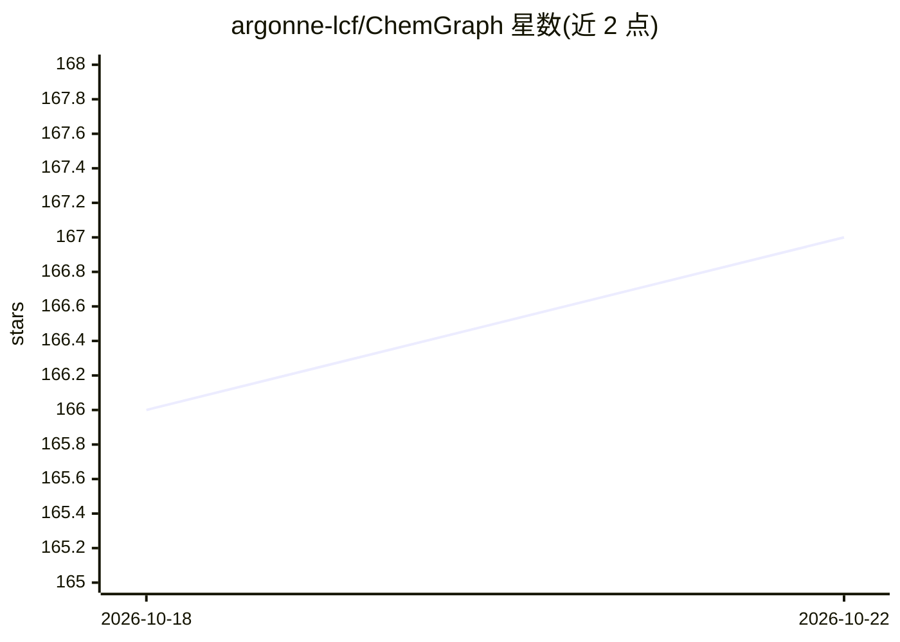

# argonne-lcf/ChemGraph

⭐ 167 · Python · Apache-2.0 · 推送 2026-10-20 · [GitHub](https://github.com/argonne-lcf/ChemGraph) · [官网](https://argonne-lcf.github.io/ChemGraph/) · 组织维护

**计算化学与材料科学的 Agent 框架：自然语言驱动分子构建、模拟与分析**

面向计算化学和材料科学研究者的 agent 框架，基于 LangGraph、ASE、RDKit 和 MCP 构建，把自然语言请求连接到分子构建、模拟、分析与报告工具。以 CLI、Python API、Streamlit 界面和 MCP 服务器四种方式使用。本地工作流支持 ASE 计算器（EMT、MACE），可选集成 TBLite、UMA、分子对接、XANES、RAG 及 ALCF Polaris/Aurora 分布式执行。支持 OpenAI、Anthropic、Google、Groq、Ollama 等模型来源，默认 gpt-4o-mini。README 提示其可启动计算并写文件，需人工审核结果。

## 筛选速览

| 维度 | 判定 | 备注 |
|---|---|---|
| AI 角色 | `ai-ecosystem` | LLM/agent 周边工具 |
| 许可风险 | `permissive` | Apache-2.0 |
| 部署形态 | `library` | 以包/库形式分发 |
| 模型依赖 | local-ok | 支持本地模型 |
| 硬件要求 | — | 无带数字的原话,不猜 |
| 安装摩擦 | `low` | 无编译、无系统依赖或容器化 |
| 成熟度 | — | 结构信号不足 |

## 能力要点

- 自然语言驱动分子构建、ASE 模拟与报告生成
- CLI / Python API / Streamlit / MCP 服务器四种使用方式
- single_agent、main_agent、multi_agent、docking、XANES 等 10 种工作流
- 可选集成 TBLite、UMA/FAIRChem、NWChem、gRASPA 等计算引擎

## 适用场景

- 用一句话查询完成分子构建与能量/频率计算
- 在交互式会话中委托 agent 执行工作区文件与化学工具任务
- 通过 MCP 把化学工具暴露给其他 AI 客户端
- 在 ALCF 超算上分布式运行模拟工作流

## 场景标签

 · 领域:科学计算/计算化学

## 证据(README 行号)

> L13: ChemGraph is an agent framework for computational chemistry and materials
> L15: simulation, analysis, and reporting tools built with LangGraph, ASE, RDKit,
> L18: Use ChemGraph from the command line, Python, a Streamlit web interface, or as

## 星数曲线

2026-10-18 166 → 2026-10-22 167（+1）

---
*卡片 v1 · prompt 1.4 · 生成 2026-10-22 · 置信度 high · 依据 README sha `e3df2270cc1e` · [字段定义](../../DATASET.md)*
