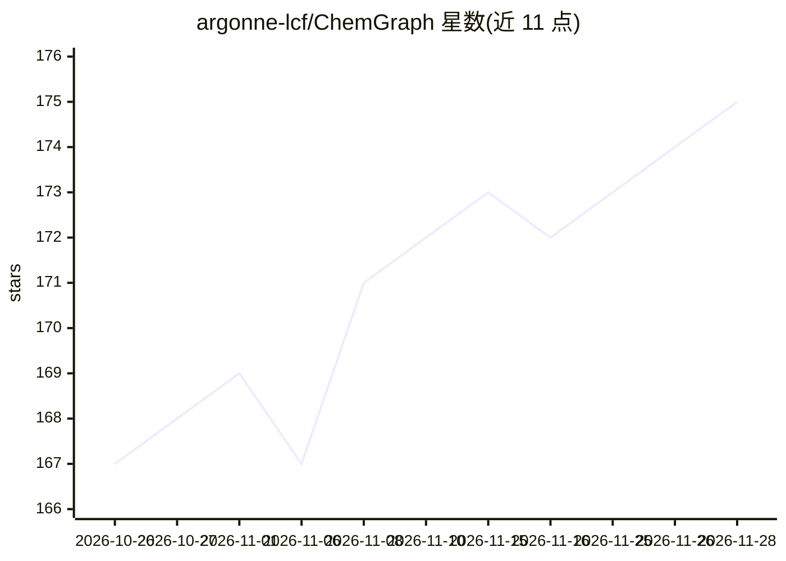

# argonne-lcf/ChemGraph

⭐ 175 · Python · Apache-2.0 · 推送 2026-11-19 · [GitHub](https://github.com/argonne-lcf/ChemGraph) · [官网](https://argonne-lcf.github.io/ChemGraph/) · 组织维护

**计算化学与材料科学领域的 agent 工作流框架**

ChemGraph 是面向计算化学与材料科学的 agent 框架，基于 LangGraph、ASE、RDKit 与 MCP 构建，将自然语言请求连接到分子构建、模拟、分析与报告工具。可从命令行、Python、Streamlit 界面或 MCP 服务器使用；支持多种模型提供商与本地 Ollama，默认模型为 gpt-4o-mini。核心安装含 ASE/EMT/MACE-MP 计算器，TBLite、UMA、分子对接、XANES、RAG 与分布式执行作为可选扩展提供，并可扩展到 ALCF Polaris/Aurora 等超算系统。需 Python 3.11 以上。

## 筛选速览

| 维度 | 判定 | 备注 |
|---|---|---|
| AI 角色 | `ai-ecosystem` | LLM/agent 周边工具 |
| 许可风险 | `permissive` | Apache-2.0 |
| 部署形态 | `self-host` | docker 或自建部署 |
| 模型依赖 | local-ok | 支持本地模型 |
| 硬件要求 | — | 无带数字的原话,不猜 |
| 安装摩擦 | `low` | 无编译、无系统依赖或容器化 |
| 成熟度 | — | 结构信号不足 |

## 能力要点

- 支持 single_agent/main_agent/multi_agent 等 6 种工作流
- 提供 CLI、Python API、Streamlit 界面与 MCP 服务器四种使用方式
- 可选 extras 扩展 TBLite/UMA、对接、XANES、RAG 与 HPC 分布式执行
- 通过 MCP 向任意 MCP 客户端暴露化学工具

## 适用场景

- 用自然语言发起分子构建与能量优化计算
- 将化学工具接入其他 MCP 客户端 agent
- 在超算系统上扩展多 agent 计算工作流

## 场景标签

`Agent 框架` `多智能体` `科研工具` · 领域:Agent 开发

## 证据(README 行号)

> L13: ChemGraph is an agent framework for computational chemistry and materials
> L15: simulation, analysis, and reporting tools built with LangGraph, ASE, RDKit,
> L18: Use it from the command line, Python, a Streamlit web interface, or as an MCP

## 星数曲线

2026-10-26 167 → 2026-11-28 175（+8）

---
*卡片 v1 · prompt 1.4 · 生成 2026-11-26 · 置信度 high · 依据 README sha `ab32ae0b8122` · [字段定义](../../DATASET.md)*
