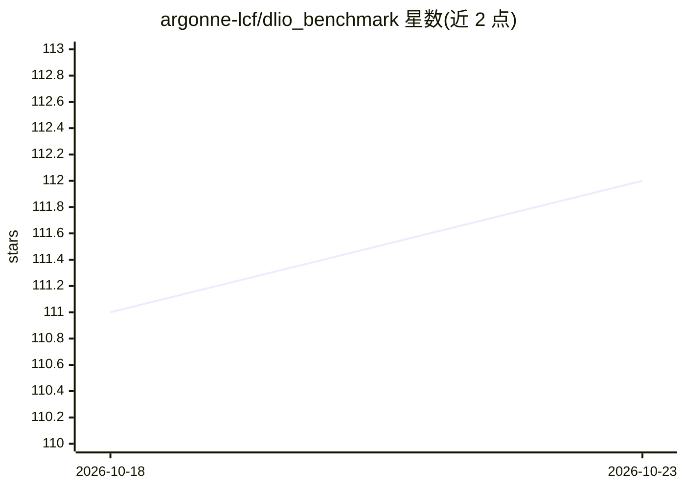

# argonne-lcf/dlio_benchmark

⭐ 112 · Python · Apache-2.0 · 推送 2026-10-20 · [GitHub](https://github.com/argonne-lcf/dlio_benchmark) · [官网](https://dlio-benchmark.readthedocs.io) · 组织维护

**深度学习应用的 I/O 基准测试工具，模拟数据加载 I/O 行为**

Argonne 实验室 ALCF 团队维护的 I/O 基准：通过 Data Generator 生成合成数据，模拟各类深度学习应用（如 UNet3D）的数据读取 I/O 模式，经 I/O Profiler 采集数据并由后处理器生成报告。支持 TensorFlow tf.data 与 PyTorch DataLoader、tfrecord/hdf5/npz/csv/jpg 等格式，存储后端含本地文件系统、AWS S3 与 AIStore。以 pip 安装的可执行文件提供，支持 Docker 容器与 PowerPC/Lassen 超算部署。限制：假设样本为 2D 图像、数据与标签同文件存储。

## 筛选速览

| 维度 | 判定 | 备注 |
|---|---|---|
| AI 角色 | `ai-ecosystem` | LLM/agent 周边工具 |
| 许可风险 | `permissive` | Apache-2.0 |
| 部署形态 | `self-host` | docker 或自建部署 |
| 模型依赖 | — | README 未给出锁定关系 |
| 硬件要求 | — | 无带数字的原话,不猜 |
| 安装摩擦 | `low` | 无编译、无系统依赖或容器化 |
| 成熟度 | `idea` | |

## 能力要点

- 生成合成数据模拟深度学习训练 I/O 模式并输出报告
- 支持 TensorFlow tf.data 与 PyTorch DataLoader
- 存储后端支持本地文件系统、AWS S3、AIStore
- Docker 容器与超算（Lassen、PowerPC）部署路径

## 适用场景

- 评估存储系统对深度学习训练负载的 I/O 性能
- 对比不同数据格式（tfrecord/hdf5/npz）的读取性能
- 为科学计算超算环境做存储选型测试

## 场景标签

 · 领域:HPC/存储与深度学习基础设施

## 证据(README 行号)

> L8: DLIO is an I/O benchmark for Deep Learning. DLIO is aimed at emulating the I/O behavior of various deep learning app
> L129: * Data Loader support: we support reading datasets using TensorFlow tf.data data loader, PyTorch DataLoader, and a

## 星数曲线

2026-10-18 111 → 2026-10-23 112（+1）

---
*卡片 v1 · prompt 1.4 · 生成 2026-10-23 · 置信度 high · 依据 README sha `2128bddfa4b3` · [字段定义](../../DATASET.md)*
