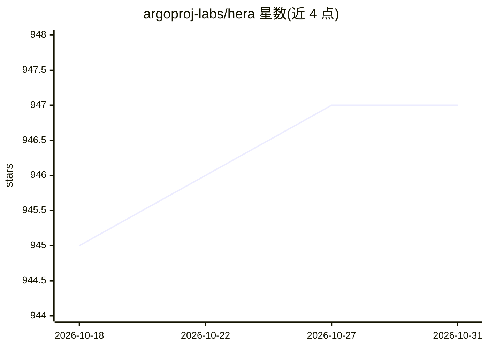

# argoproj-labs/hera

⭐ 947 · Python · Apache-2.0 · 推送 2026-10-30 · [GitHub](https://github.com/argoproj-labs/hera) · [官网](https://hera.rtfd.io) · 组织维护

**在 Python 中构建与提交 Argo Workflows 的原生 SDK**

面向 Argo Workflows 的 Python SDK：把 Python 函数转换为容器化模板，在 Python 代码内构建并提交工作流到 Kubernetes。要求集群中已部署 Argo Workflows 服务器；支持 Bearer token 认证或端口转发到 localhost 提交。提供 PyPI 安装与可选依赖（yaml 输出、实验性 CLI 做 YAML/Python 互转、async 异步客户端），社区展示中含 LLM 训练与数据科学工作流案例。

## 筛选速览

| 维度 | 判定 | 备注 |
|---|---|---|
| AI 角色 | `ai-ecosystem` | LLM/agent 周边工具 |
| 许可风险 | `permissive` | Apache-2.0 |
| 部署形态 | `library` | 以包/库形式分发 |
| 模型依赖 | — | README 未给出锁定关系 |
| 硬件要求 | — | 无带数字的原话,不猜 |
| 安装摩擦 | `low` | 无编译、无系统依赖或容器化 |
| 成熟度 | `idea` | |

## 能力要点

- Python 函数转为容器化模板并在 Kubernetes 上运行
- 支持 Bearer token 认证与端口转发两种提交方式
- 可选 CLI 支持 YAML 与 Python 源码互转（实验性）
- 可选 async-client 提供 httpx 异步工作流服务

## 适用场景

- 用纯 Python 代码编写并提交 Argo 工作流
- 数据科学与机器学习任务在 Kubernetes 上编排
- 通过 YAML 输出实践 GitOps 流程

## 场景标签

`工作流自动化` · 领域:效率与自动化

## 证据(README 行号)

> L3: |Hera mascot|Hera is the go-to Python SDK to make Argo Workflows simple and intuitive. Easily turn Python functions 
> L43: Hera requires an Argo Workflows server to be deployed to a Kubernetes cluster. To learn how to deploy Argo to your 
> L103: - KubeCon/ArgoCon NA 2023 - How to Train an LLM with Argo Workflows and Hera

## 星数曲线

2026-10-18 945 → 2026-10-31 947（+2）

---
*卡片 v1 · prompt 1.4 · 生成 2026-10-21 · 置信度 high · 依据 README sha `ec191567d972` · [字段定义](../../DATASET.md)*
