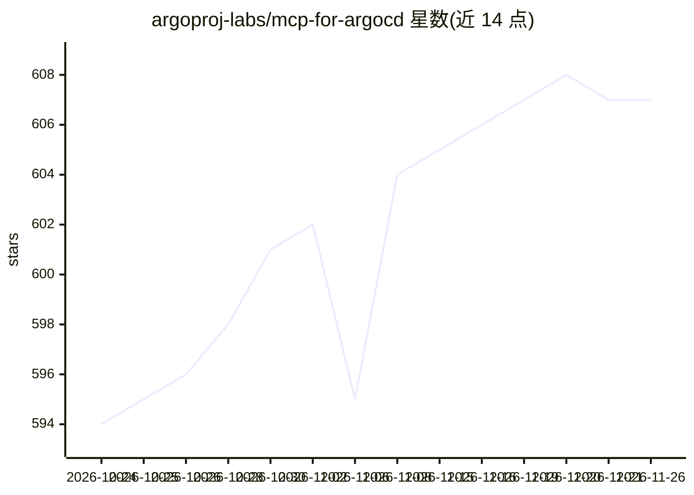

# argoproj-labs/mcp-for-argocd

⭐ 607 · TypeScript · Apache-2.0 · 推送 2026-11-24 · [GitHub](https://github.com/argoproj-labs/mcp-for-argocd) · [官网](https://www.npmjs.com/package/argocd-mcp) · 组织维护

**让 AI 助手用自然语言管理 Argo CD 应用的 MCP 服务器**

面向 Argo CD 的 Model Context Protocol 服务器，通过 stdio 与 HTTP stream 两种传输协议接入 VS Code、Cursor、Claude Desktop 等 MCP 客户端，使 AI 助手以自然语言操作 Argo CD。提供集群、项目、应用（增删改查、同步）、资源（清单、事件、日志、动作执行）四组共 18 个工具。凭据通过 API token（header/环境变量/JSON 注册表）与 base URL 提供，包含默认 token 与按实例注册 token 的解析顺序、防 token 外泄绑定规则，以及 HTTP 监听的入站访问控制配置。

## 筛选速览

| 维度 | 判定 | 备注 |
|---|---|---|
| AI 角色 | `ai-ecosystem` | LLM/agent 周边工具 |
| 许可风险 | `permissive` | Apache-2.0 |
| 部署形态 | `desktop` | 安装包/桌面程序 |
| 模型依赖 | — | README 未给出锁定关系 |
| 硬件要求 | — | 无带数字的原话,不猜 |
| 安装摩擦 | `low` | 无编译、无系统依赖或容器化 |
| 成熟度 | — | 结构信号不足 |

## 能力要点

- 18 个 ArgoCD 管理工具：应用增删改查与同步、资源树/清单/日志/事件读取与动作执行
- stdio 与 HTTP stream 双传输协议
- 默认 token 与按实例 token 注册表的两级凭据解析，防 token 被提示注入外发
- HTTP 监听支持绑定地址、入站 Bearer token、Host/Origin 白名单等访问控制

## 适用场景

- 在 VS Code 或 Cursor 中用自然语言查询和管理 Argo CD 应用
- 通过 AI 助手触发应用同步与资源动作
- 用一个 MCP 服务器管理多个 Argo CD 实例

## 场景标签

 · 领域:DevOps/GitOps 工具链

## 证据(README 行号)

> L3: An implementation of Model Context Protocol (MCP) server for Argo CD, enabling AI assistants to interact with your A
> L15: - **Transport Protocols**: Supports both stdio and HTTP stream transport modes for flexible integration with differ
> L17: - **AI Assistant Ready**: Pre-configured tools for AI assistants to interact with Argo CD in natural language

## 星数曲线

2026-10-24 594 → 2026-11-26 607（+13）

---
*卡片 v1 · prompt 1.4 · 生成 2026-11-26 · 置信度 high · 依据 README sha `3addd96672fb` · [字段定义](../../DATASET.md)*
