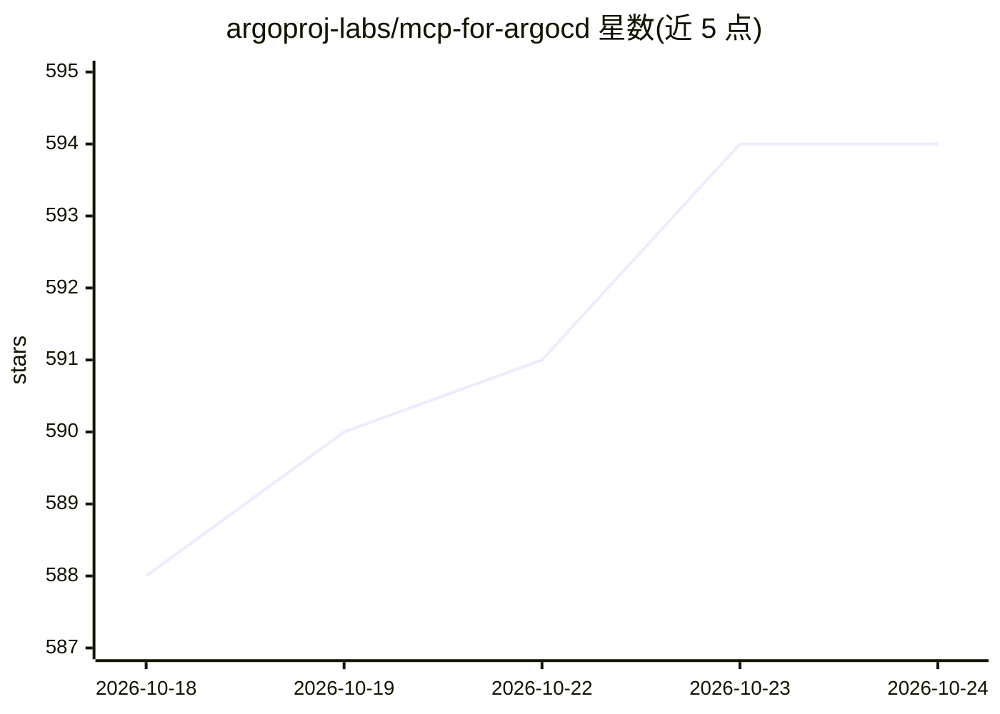

# argoproj-labs/mcp-for-argocd

⭐ 595 · TypeScript · Apache-2.0 · 推送 2026-10-16 · [GitHub](https://github.com/argoproj-labs/mcp-for-argocd) · [官网](https://www.npmjs.com/package/argocd-mcp) · 组织维护

**面向 Argo CD 的 MCP 服务器，让 AI 助手用自然语言管理 Argo CD**

为 Argo CD 实现 Model Context Protocol 服务器，使 VS Code、Cursor、Claude Desktop 等 MCP 客户端中的 AI 助手能通过自然语言操作 Argo CD：提供集群、项目、应用、资源四类工具，覆盖列表/创建/更新/删除/同步应用、读取资源树与工作负载日志、执行资源动作等。支持 stdio 与 HTTP 流两种传输。凭据方面，API token 仅经 header/env var 传入、不进入工具调用参数；默认 token 绑定默认 base URL，多实例需配置 token 注册表文件以防 token 外泄。HTTP 监听默认仅绑定回环地址。

## 筛选速览

| 维度 | 判定 | 备注 |
|---|---|---|
| AI 角色 | `ai-ecosystem` | LLM/agent 周边工具 |
| 许可风险 | `permissive` | Apache-2.0 |
| 部署形态 | `desktop` | 安装包/桌面程序 |
| 模型依赖 | — | README 未给出锁定关系 |
| 硬件要求 | — | 无带数字的原话,不猜 |
| 安装摩擦 | `low` | 无编译、无系统依赖或容器化 |
| 成熟度 | — | 结构信号不足 |

## 能力要点

- 四类 Argo CD 工具：集群/项目/应用/资源管理（含创建、删除、同步、执行资源动作）
- stdio 与 HTTP 流双传输模式
- API token 仅从传输层读取，不进入提示词或工具调用日志
- token 注册表支持多 Argo CD 实例，默认 token 绑定默认 base URL 防外泄

## 适用场景

- 在 IDE 的 AI 助手中用自然语言查询和操作 Argo CD 应用
- 通过 MCP 客户端触发应用同步、查看工作负载日志与事件
- 一个服务器管理多个 Argo CD 实例（token 注册表）

## 场景标签

 · 领域:DevOps/Kubernetes 工具链

## 证据(README 行号)

> L3: An implementation of Model Context Protocol (MCP) server for Argo CD, enabling AI assistants to interact with your A
> L15: - **Transport Protocols**: Supports both stdio and HTTP stream transport modes for flexible integration with differ
> L17: - **AI Assistant Ready**: Pre-configured tools for AI assistants to interact with Argo CD in natural language

## 星数曲线

2026-10-18 588 → 2026-10-24 594（+6）

---
*卡片 v1 · prompt 1.4 · 生成 2026-10-21 · 置信度 high · 依据 README sha `189227f1fb18` · [字段定义](../../DATASET.md)*
