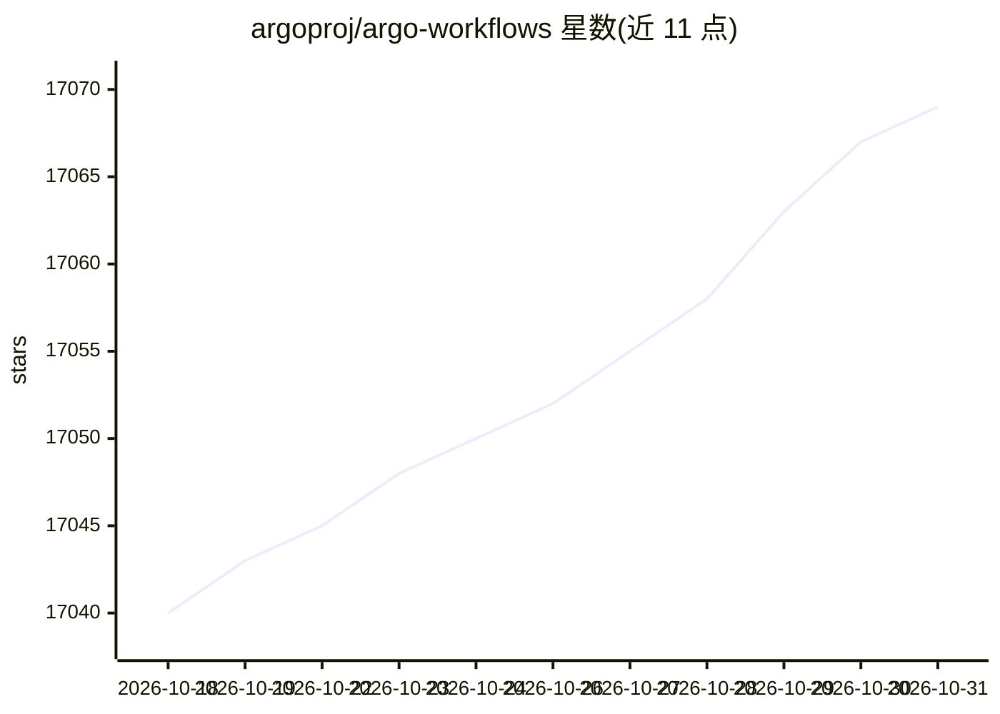

# argoproj/argo-workflows

⭐ 17,069 · Go · Apache-2.0 · 推送 2026-10-30 · [GitHub](https://github.com/argoproj/argo-workflows) · [官网](https://argo-workflows.readthedocs.io/) · 组织维护

**面向 Kubernetes 的容器化并行任务工作流引擎**

Argo Workflows 是以 Kubernetes CRD 形式实现的开源工作流引擎，用于编排并行作业：每个步骤以容器运行，支持以任务序列或 DAG 建模多步骤流程。提供工作流模板、cron 定时调度、归档、重试/超时/挂起恢复、步骤级输入输出、UI 管理界面、REST/gRPC 服务端接口以及 Java/Golang/Python/TypeScript SDK。制品存储支持 S3、GCS、Azure Blob 等。面向在 Kubernetes 上运行机器学习、数据处理、CI/CD 等计算密集型作业的用户。为 CNCF 毕业项目。

## 筛选速览

| 维度 | 判定 | 备注 |
|---|---|---|
| AI 角色 | `ai-ecosystem` | LLM/agent 周边工具 |
| 许可风险 | `permissive` | Apache-2.0 |
| 部署形态 | `None` |  |
| 模型依赖 | — | README 未给出锁定关系 |
| 硬件要求 | — | 无带数字的原话,不猜 |
| 安装摩擦 | `low` | 无编译、无系统依赖或容器化 |
| 成熟度 | — | 结构信号不足 |

## 动量与使用信号

- 维护:`active` — 距上次 push 0.9 天,年发版 48,425 位贡献者
- 涨星:近 1 天 **+0**(自 20261016 起算)
- 下载:GitHub Release 附件 累计 10,847,848(100 个 release)

## 能力要点

- 以 Kubernetes CRD 实现，每步为一个容器
- 支持 DAG 与 Steps 两种工作流声明方式
- 提供 UI、REST/gRPC 接口与四种语言 SDK
- 支持 cron 调度、重试、超时、归档、并行度限制等

## 适用场景

- 在 Kubernetes 上运行机器学习训练流水线
- 数据与批处理作业编排
- 搭建 CI/CD 流水线
- 基础设施自动化任务编排

## 场景标签

`工作流自动化` `MLOps` · 领域:效率与自动化

## 证据(README 行号)

> L14: Argo Workflows is an open source container-native workflow engine for orchestrating parallel jobs on Kubernetes.
> L15: Argo Workflows is implemented as a Kubernetes CRD (Custom Resource Definition).
> L21: Argo is a Cloud Native Computing Foundation (CNCF) graduated project.

## 星数曲线

2026-10-18 17,040 → 2026-10-31 17,069（+29）

---
*卡片 v1 · prompt 1.4 · 生成 2026-10-18 · 置信度 high · 依据 README sha `95512c65a73b` · [字段定义](../../DATASET.md)*
