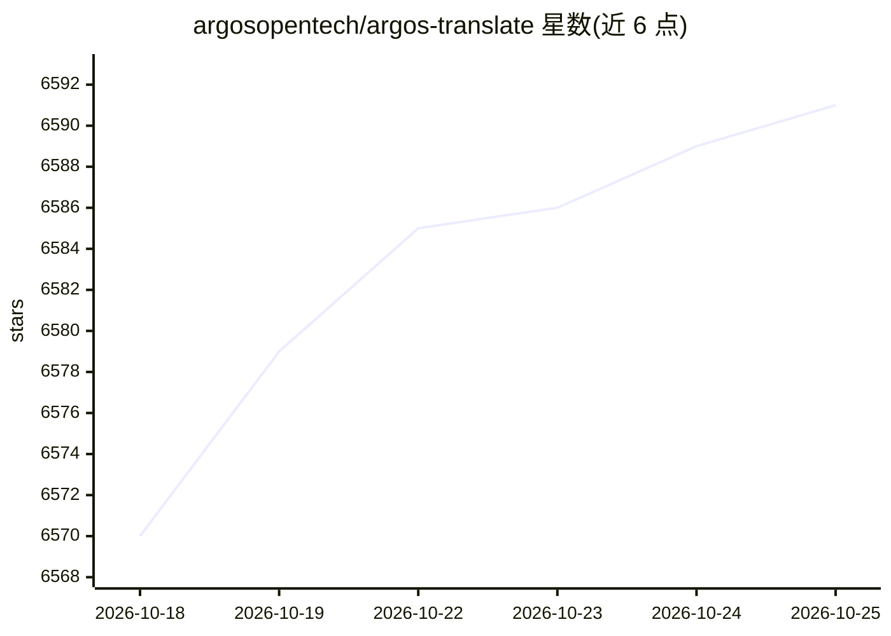

# argosopentech/argos-translate

⭐ 6,592 · Python · MIT · 推送 2026-08-08 · [GitHub](https://github.com/argosopentech/argos-translate) · [官网](https://www.argosopentech.com) · 组织维护

**离线机器翻译 Python 库，可直接产出翻译结果**

基于 OpenNMT（经 CTranslate2）的开源离线翻译库，可作为 Python 库、命令行工具或 GUI 应用使用；通过安装 .argosmodel 语言包实现翻译，支持 30+ 种语言，并可在无直接语言对时自动经中间语言（如 es→en→fr）中转翻译。提供 argospm 包管理器、GPU（CUDA）加速开关、HTML 与文件翻译扩展库。LibreTranslate 是构建于其上的 API/Web 应用。语言包与训练脚本另行获取。

## 筛选速览

| 维度 | 判定 | 备注 |
|---|---|---|
| AI 角色 | `ai-native` | 本体是模型或模型工具 |
| 许可风险 | `permissive` | MIT |
| 部署形态 | `library` | 以包/库形式分发 |
| 模型依赖 | — | README 未给出锁定关系 |
| 硬件要求 | — | 无带数字的原话,不猜 |
| 安装摩擦 | `medium` | 含编译或系统依赖之一 |
| 成熟度 | — | 结构信号不足 |

## 能力要点

- Python 库/CLI/GUI 三种使用形态
- 30+ 语言包，缺直接语言对时自动经中间语言中转
- CTranslate2 后端，ARGOS_DEVICE_TYPE=cuda 可启用 GPU 加速
- 扩展库支持 HTML 与文件翻译

## 适用场景

- 在无网络或隐私敏感环境做离线文本翻译
- 为应用嵌入程序化的机器翻译能力
- 通过 LibreTranslate 提供翻译 API 与 Web 界面

## 场景标签

 · 领域:NLP/机器翻译

## 证据(README 行号)

> L4: **Open-source offline translation library written in Python**
> L6: Argos Translate uses OpenNMT for translations and can be used as either a Python library, command-line, or GUI appli

## 星数曲线

2026-10-18 6,570 → 2026-10-25 6,591（+21）

---
*卡片 v1 · prompt 1.4 · 生成 2026-10-20 · 置信度 high · 依据 README sha `104101a769dc` · [字段定义](../../DATASET.md)*
