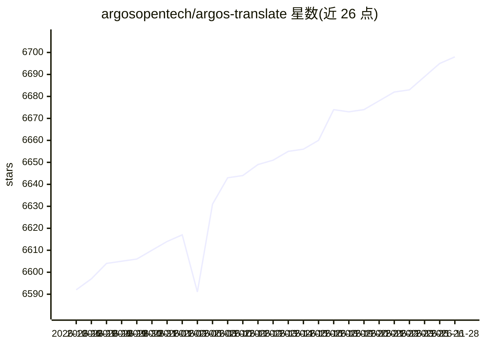

# argosopentech/argos-translate

⭐ 6,698 · Python · MIT · 推送 2026-11-17 · [GitHub](https://github.com/argosopentech/argos-translate) · [官网](https://www.argosopentech.com) · 个人维护

**离线开源机器翻译库：本地运行语言模型包翻译文本**

基于 OpenNMT/CTranslate2 的 Python 离线翻译库，以库、命令行和 GUI 三种形式提供。翻译模型以 .argosmodel zip 包形式安装，支持 38+ 语言对；对未直接安装的语言对可经中间语言自动枢轴翻译（有质量损失）。模型包索引由 argospm 管理，另有付费定制模型训练服务。GPU 加速需设 ARGOS_DEVICE_TYPE=cuda，默认 CPU 运行。

## 筛选速览

| 维度 | 判定 | 备注 |
|---|---|---|
| AI 角色 | `ai-native` | 本体是模型或模型工具 |
| 许可风险 | `permissive` | MIT |
| 部署形态 | `library` | 以包/库形式分发 |
| 模型依赖 | — | README 未给出锁定关系 |
| 硬件要求 | — | 无带数字的原话,不猜 |
| 安装摩擦 | `medium` | 含编译或系统依赖之一 |
| 成熟度 | — | 结构信号不足 |

## 能力要点

- 完全离线运行，模型以 .argosmodel 包安装
- 自动枢轴翻译：经中间语言扩展可用语言组合
- Python 库 / CLI / GUI 三种使用形式
- 支持 CUDA GPU 加速（ARGOS_DEVICE_TYPE 环境变量）

## 适用场景

- 无网络环境下本地翻译文本
- 在应用中以 Python 库集成离线翻译能力
- 为定制语言对训练自己的翻译模型

## 场景标签

 · 领域:自然语言处理/机器翻译

## 证据(README 行号)

> L4: **Open-source offline translation library written in Python**
> L6: Argos Translate uses OpenNMT for translations and can be used as either a Python library, command-line, or GUI appli

## 星数曲线

2026-10-26 6,592 → 2026-11-28 6,698（+106）

---
*卡片 v1 · prompt 1.4 · 生成 2026-11-22 · 置信度 high · 依据 README sha `9a1a98c5fbf3` · [字段定义](../../DATASET.md)*
