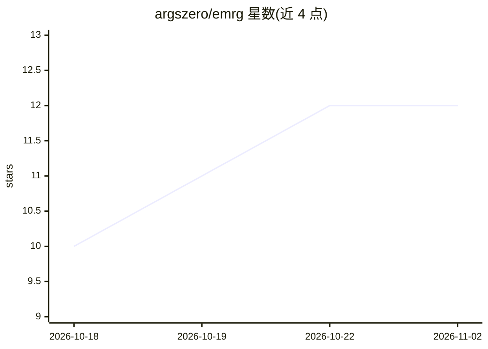

# argszero/emrg

⭐ 12 · Python · MIT · 推送 2026-11-01 · [GitHub](https://github.com/argszero/emrg) · 个人维护 · 中文 README

**自称可自我改进的终端/GUI 编程 AI agent**

面向个人开发者的编程 AI agent：读文件、执行命令、编辑代码，核心机制是 /rant 反馈驱动“进化循环”——读取用户抱怨与 issues，自行修改自身代码/提示词/工具链，跑测试通过后提交 PR。本地运行，使用用户自己的 LLM API key，状态存于本机磁盘；不改模型权重，也不改用户项目文件。提供 Electron GUI（macOS/Windows/Linux 安装包）与 TUI + 常驻 daemon，含会话管理、三档沙箱、子代理、定时任务、技能系统，MIT 许可。README 自述为实验项目。

## 筛选速览

| 维度 | 判定 | 备注 |
|---|---|---|
| AI 角色 | `ai-native` | 本体是模型或模型工具 |
| 许可风险 | `permissive` | MIT |
| 部署形态 | `desktop` | 安装包/桌面程序 |
| 模型依赖 | — | README 未给出锁定关系 |
| 硬件要求 | — | 无带数字的原话,不猜 |
| 安装摩擦 | `low` | 无编译、无系统依赖或容器化 |
| 成熟度 | `idea` | |

## 能力要点

- /rant 反馈驱动的自我进化循环，改动经测试后以 PR 形式合并
- Electron GUI 与 TUI + 常驻 emrgd daemon 双入口
- 三级沙箱（read-only / workspace-write / danger-full-access）与子代理
- 自带 API key、本地保存状态，自我进化仅限自身仓库

## 适用场景

- 让 AI 代为读码、执行命令与编辑文件完成编程任务
- 通过抱怨/反馈驱动 agent 自动改进自身功能
- 在后台 daemon 上长期运行并随时重连会话

## 场景标签

`编码 Agent` · 领域:编码与开发

## 证据(README 行号)

> L17: EMRG is an experiment in *autonomous self-improvement*: an AI agent that helps you code — reading files, running co
> L114: |**Just type**|Ask EMRG anything — it reads files, runs commands, makes edits|
> L163: **Is this real — does it actually modify its own code?**

## 星数曲线

2026-10-18 10 → 2026-11-02 12（+2）

---
*卡片 v1 · prompt 1.4 · 生成 2026-11-01 · 置信度 high · 依据 README sha `dba88a4fc0dd` · [字段定义](../../DATASET.md)*
