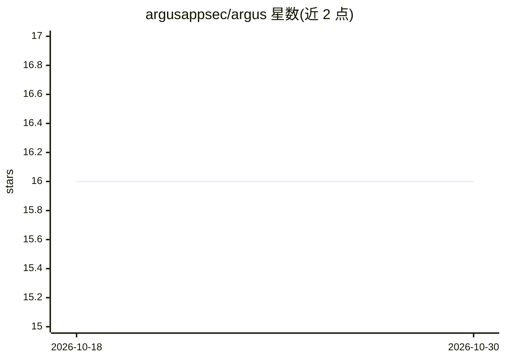

# argusappsec/argus

⭐ 16 · Go · Apache-2.0 · 推送 2026-10-21 · [GitHub](https://github.com/argusappsec/argus) · [官网](https://github.com/argusappsec/argus/blob/main/docs/guide/getting-started.md) · 组织维护

**开源应用安全 agent：以对话方式做代码安全审查**

Go 编写的应用安全 agent，以单个组织级守护进程（argusd）运行：将 opengrep/semgrep、gitleaks、osv-scanner 等真实扫描器封装为结构化工具，由语言模型结合组织上下文（SOUL 文件、记忆与知识库）对扫描结果做研判，用自然语言说明哪些问题重要。支持终端聊天、GitHub PR 自动审查、MCP 接入三种通道；每次模型调用附带组织画像，操作记录于追加式审计日志；针对提示注入做了隔离与最小权限处理。当前为 pre-1.0 阶段，配置模式可能在次版本间变更。

## 筛选速览

| 维度 | 判定 | 备注 |
|---|---|---|
| AI 角色 | `ai-native` | 本体是模型或模型工具 |
| 许可风险 | `permissive` | Apache-2.0 |
| 部署形态 | `self-host` | docker 或自建部署 |
| 模型依赖 | — | README 未给出锁定关系 |
| 硬件要求 | — | 无带数字的原话,不猜 |
| 安装摩擦 | `low` | 无编译、无系统依赖或容器化 |
| 成熟度 | — | 结构信号不足 |

## 能力要点

- 将 opengrep/semgrep、gitleaks、osv-scanner 等扫描器封装为结构化工具，模型不获得通用 bash/exec
- SOUL 组织画像文件随每次模型调用携带，结合记忆与主题知识库保持上下文
- 终端聊天、GitHub PR 审查、MCP 三种通道，Slack 为计划中
- 内置 4 个技能（授权审计、PR 快速检查、密钥轮换计划、STRIDE 威胁建模）

## 适用场景

- 在 PR 中自动做安全审查并与 agent 讨论发现是否真实
- 让团队通过终端或自有 AI 工具（MCP）咨询代码安全问题
- 结合组织技术栈与合规要求对扫描结果做优先级研判

## 场景标签

`代码审查` `网络安全` · 领域:编码与开发

## 证据(README 行号)

> L11: Argus is an open-source **application security agent** that reviews code the
> L24: are wrapped as structured tools, the model is disciplined by curated
> L58: - **Real scanners, no shell escape.** `opengrep` or `semgrep`, `gitleaks`, and

## 星数曲线

2026-10-18 16 → 2026-10-30 16（+0）

---
*卡片 v1 · prompt 1.4 · 生成 2026-10-30 · 置信度 high · 依据 README sha `2968e2c4c8d4` · [字段定义](../../DATASET.md)*
