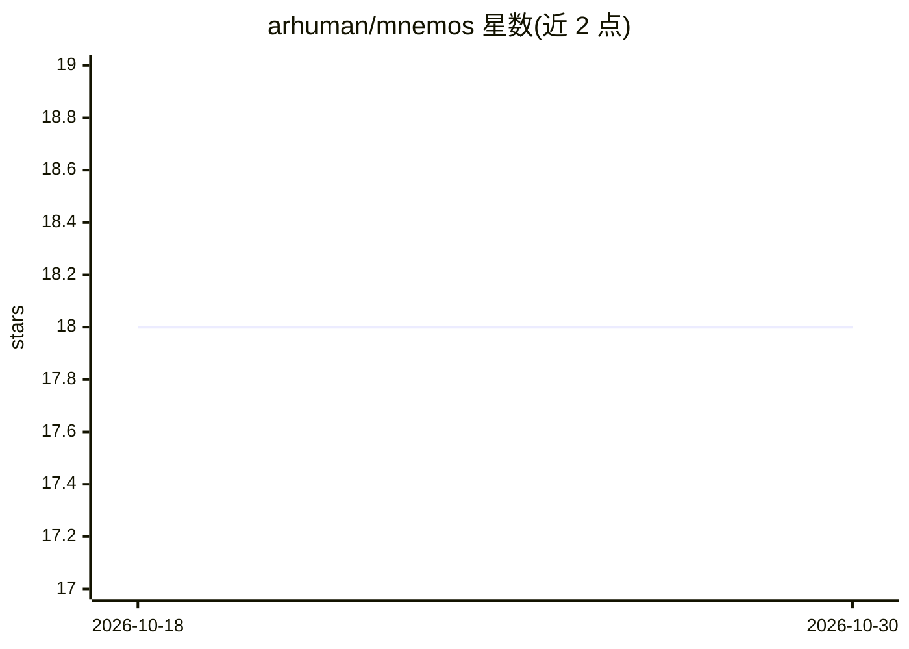

# arhuman/mnemos

⭐ 18 · Go · NOASSERTION · 推送 2026-10-26 · [GitHub](https://github.com/arhuman/mnemos) · 个人维护

**本地优先的 MCP 记忆服务器：为 AI agent 提供可引用出处的项目记忆**

用单个 cgo-free Go 二进制实现本地 MCP 记忆服务器：将 Markdown 文件、ADR、笔记与源码索引到 SQLite/FTS5（bm25），通过 MCP 协议供 Claude Code 等 agent 检索、读取并引用，每条结果精确到 file#section 与行号范围。支持快照入库（add）与原位只读注册（origin）两种方式，含增量文件监视、秘密扫描、remember/forget 读写记忆与 OKF 知识库。可选语义/混合检索构建（all-MiniLM-L6-v2）。默认只读，写入需在配置中开启。需 Go 1.25+ 从源码构建。

## 筛选速览

| 维度 | 判定 | 备注 |
|---|---|---|
| AI 角色 | `ai-ecosystem` | LLM/agent 周边工具 |
| 许可风险 | `permissive` | NOASSERTION |
| 部署形态 | `None` |  |
| 模型依赖 | — | README 未给出锁定关系 |
| 硬件要求 | — | 无带数字的原话,不猜 |
| 安装摩擦 | `medium` | 含编译或系统依赖之一 |
| 成熟度 | — | 结构信号不足 |

## 能力要点

- SQLite FTS5/bm25 全文检索，结果精确到 file#section 与行号范围
- 单个 cgo-free Go 二进制，无向量库/Python/Node 服务依赖
- 可选语义+混合检索（构建标签启用，安装 all-MiniLM-L6-v2）
- 秘密扫描、路径受限写入、remember/forget 读写记忆与任务管理

## 适用场景

- 让 Claude Code 回答项目问题时引用我自己的 ADR 和文档
- 给编码 agent 建立可溯源、本地存储的项目长期记忆
- 将多个文档树合并为一个可检索、可引用的知识库

## 场景标签

`Agent 记忆` `知识库管理` · 领域:Agent 开发

## 证据(README 行号)

> L29: No vector database. No Ollama. No Python or Node service. Just one cgo-free Go binary
> L31: MCP, so Claude can **search, read, and cite your own
> L118: your files  →  mnemos index (SQLite/FTS5)  →  Claude Code memory  →  cited answers

## 星数曲线

2026-10-18 18 → 2026-10-30 18（+0）

---
*卡片 v1 · prompt 1.4 · 生成 2026-10-29 · 置信度 high · 依据 README sha `0c1c31cc4cf7` · [字段定义](../../DATASET.md)*
