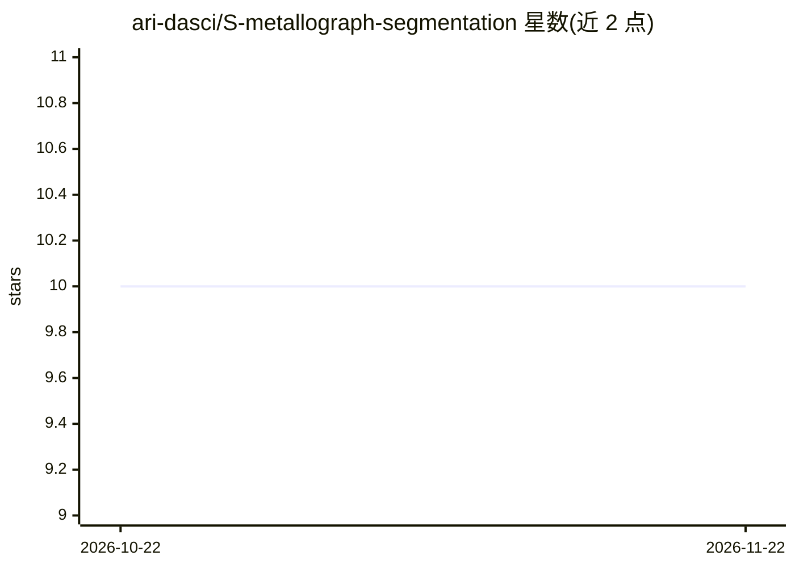

# ari-dasci/S-metallograph-segmentation

⭐ 10 · Python · GPL-3.0 · 推送 2026-10-22 · [GitHub](https://github.com/ari-dasci/S-metallograph-segmentation) · [官网](https://www.sciencedirect.com/science/article/pii/S1566253521001949) · 组织维护

**为材料科研人员提供金相显微组织语义分割模型代码**

与 ArcelorMittal 合作开发、伴随 MetalDAM 教程论文发布的语义分割代码库，含 5 个自包含模型家族（U-Net 系列、多视角、stacking、无监督/半监督 DRNet、PixelNet），共享工具代码覆盖配置读取、数据加载、交叉验证、损失与指标。需要同时安装 PyTorch 与 TensorFlow，数据集需用户自行准备本地 HDF5 文件，训练脚本通过 INI 配置文件驱动；包不在 PyPI 上，需克隆源码安装。

## 筛选速览

| 维度 | 判定 | 备注 |
|---|---|---|
| AI 角色 | `ai-native` | 本体是模型或模型工具 |
| 许可风险 | `viral` | GPL-3.0 |
| 部署形态 | `library` | 以包/库形式分发 |
| 模型依赖 | — | README 未给出锁定关系 |
| 硬件要求 | — | 无带数字的原话,不猜 |
| 安装摩擦 | `low` | 无编译、无系统依赖或容器化 |
| 成熟度 | — | 结构信号不足 |

## 能力要点

- 5 个自包含分割模型家族，各自带独立训练入口
- 共享工具代码提供交叉验证、损失、指标与预测保存
- INI 配置文件驱动训练，附示例配置与格式检查脚本
- 配套 MetalDAM 教程论文与引用信息

## 适用场景

- 对金相显微图像做语义分割训练与实验
- 复现 MetalDAM 论文中的集成模型与分析
- 在自有分割数据集上运行交叉验证实验

## 场景标签

`目标检测` · 领域:感知与多模态

## 证据(README 行号)

> L3: Code for semantic segmentation models and techniques applied to metal microstructures, in
> L15: |`models/sm`|Segmentation models (U-Net and relatives, via `segmentation-models-pytorch`).|

## 星数曲线

2026-10-22 10 → 2026-11-22 10（+0）

---
*卡片 v1 · prompt 1.4 · 生成 2026-11-20 · 置信度 mid · 依据 README sha `99a68c11c7fd` · [字段定义](../../DATASET.md)*
