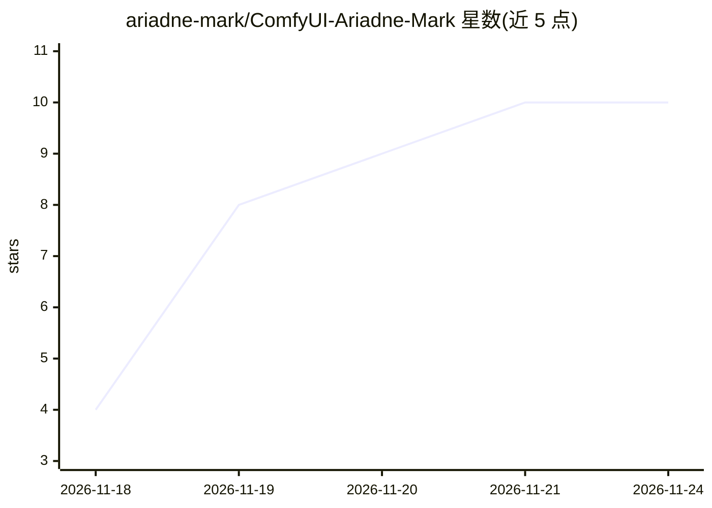

# ariadne-mark/ComfyUI-Ariadne-Mark

⭐ 10 · Python · Apache-2.0 · 推送 2026-11-20 · [GitHub](https://github.com/ariadne-mark/ComfyUI-Ariadne-Mark) · [官网](https://ariadnemark.xyz/ariadne/) · 个人维护

**为 ComfyUI 输出图像视频加隐形水印与 C2PA 签名凭证**

ComfyUI 自定义节点集，在导出环节为生成的图像和视频添加隐形水印、签名的 C2PA 出处信息并生成验证回执。适配器在隔离进程中调用既有的 Ariadne SDK 0.7.3a4 部署套件，不重装 Torch、不替换 ComfyUI 依赖、不上传媒体到外部服务。三个节点分别处理图像批次导出、视频导出与已保存文件标记。当前 Comfy Registry 上 0.1.0 版本被标记为 Flagged，无可用标准安装版本。

## 筛选速览

| 维度 | 判定 | 备注 |
|---|---|---|
| AI 角色 | `ai-enhanced` | 去掉 AI 部分产品仍成立 |
| 许可风险 | `permissive` | Apache-2.0 |
| 部署形态 | `self-host` | docker 或自建部署 |
| 模型依赖 | — | README 未给出锁定关系 |
| 硬件要求 | — | 无带数字的原话,不猜 |
| 安装摩擦 | `low` | 无编译、无系统依赖或容器化 |
| 成熟度 | — | 结构信号不足 |

## 能力要点

- 三个终端导出节点：图像批次、视频 MP4、已保存 PNG/JPEG/MP4 文件标记
- 在隔离进程中调用外部 Ariadne SDK，不修改 ComfyUI 依赖与水印算法
- 输出目录含 .receipt.json 回执与 export.json 索引，导出前逐个校验哈希
- 支持 Economy5s/Economy2s/Resilient 三种视频档案

## 适用场景

- 给 ComfyUI 生成的图像批量加隐形水印与 C2PA 出处
- 导出带签名的 MP4 视频并生成验证回执
- 用 C2PA 阅读器验证已有生成媒体的出处信息

## 场景标签

`图像视频处理` · 领域:感知与多模态

## 证据(README 行号)

> L3: Export AI-generated images and video with **invisible watermarks, signed C2PA provenance and a verification receipt*
> L11: The adapter uses the existing **Ariadne Mark 0.7.3a4** SDK in an isolated process. It does not install another Torc

## 星数曲线

2026-11-18 4 → 2026-11-24 10（+6）

---
*卡片 v1 · prompt 1.4 · 生成 2026-11-20 · 置信度 mid · 依据 README sha `4e01ef27344e` · [字段定义](../../DATASET.md)*
