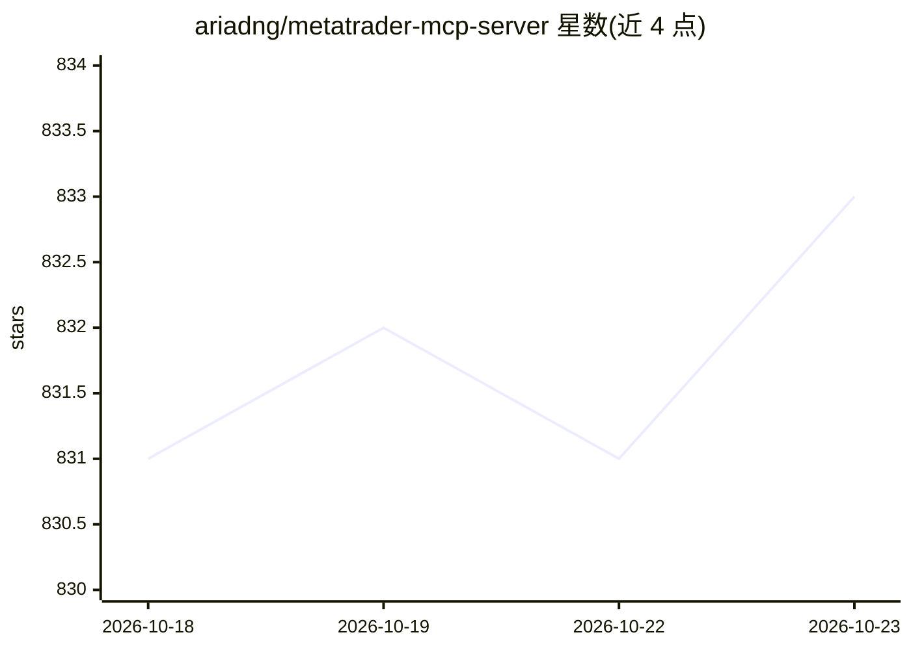

# ariadng/metatrader-mcp-server

⭐ 833 · Python · MIT · 推送 2026-03-28 · [GitHub](https://github.com/ariadng/metatrader-mcp-server) · 个人维护

**连接 AI 助手与 MetaTrader 5 的 MCP 服务器：自然语言交易**

在 AI 助手（Claude Desktop、ChatGPT via Open WebUI 等）与 MetaTrader 5 交易平台之间提供 MCP/REST/WebSocket 三类接口：AI 通过 32 个交易工具读取账户与行情数据、执行市价/挂单、修改与平仓操作。附带 Claude 可用的 Trading Terminal Assistant 技能，以及流式推送实时 tick 的 WebSocket Quote Server。要求 Python 3.10+ 与本机 MT5 终端，凭据保留在本地；MCP 协议本身不含认证，暴露 SSE 端口需自行防护。用户为交易者、量化开发者和分析师。

## 筛选速览

| 维度 | 判定 | 备注 |
|---|---|---|
| AI 角色 | `ai-ecosystem` | LLM/agent 周边工具 |
| 许可风险 | `permissive` | MIT |
| 部署形态 | `desktop` | 安装包/桌面程序 |
| 模型依赖 | — | README 未给出锁定关系 |
| 硬件要求 | — | 无带数字的原话,不猜 |
| 安装摩擦 | `low` | 无编译、无系统依赖或容器化 |
| 成熟度 | — | 结构信号不足 |

## 能力要点

- 32 个交易工具：账户查询、行情/K线、下单/挂单、持仓与挂单管理
- MCP（STDIO/SSE）、REST API、WebSocket 三种接口形态
- WebSocket Quote Server 流式推送实时 tick（bid/ask/spread/volume）
- 内置 Claude Code/Claude Desktop 可安装的 Trading Terminal Assistant 技能

## 适用场景

- 在 Claude Desktop 对话中直接查询账户余额、行情并下单
- 构建量化交易机器人或行情监控面板，通过 REST/WebSocket 获取数据
- 在 Windows VPS 上远程运行 MCP 服务器供本地客户端连接

## 场景标签

`金融量化` · 领域:学习与行业

## 证据(README 行号)

> L17: **MetaTrader MCP Server** is a bridge that connects AI assistants (like Claude, ChatGPT) to the MetaTrader 5 tradin
> L28: You → AI Assistant → MCP Server → MetaTrader 5 → Your Trades
> L34: - **🤖 Multi-AI Support** - Works with Claude Desktop, ChatGPT (via Open WebUI), and more

## 星数曲线

2026-10-18 831 → 2026-10-23 833（+2）

---
*卡片 v1 · prompt 1.4 · 生成 2026-10-21 · 置信度 high · 依据 README sha `7fbedf81af30` · [字段定义](../../DATASET.md)*
