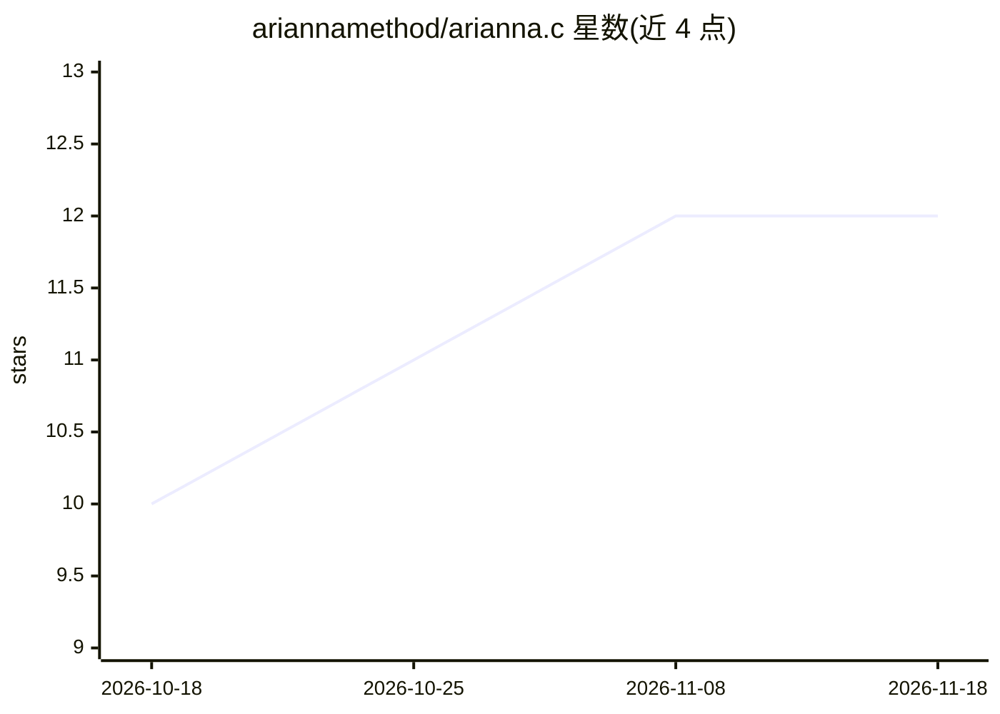

# ariannamethod/arianna.c

⭐ 12 · C · 推送 2026-10-20 · [GitHub](https://github.com/ariannamethod/arianna.c) · [官网](http://x.com/olegataeff) · 个人维护

**多语言协作构建的数字人格对话体，可直接生成回复**

由 C、Go、Zig、Julia 多语言协作构建的数字人格对话体：Janus 与 Resonance 两个语言模型声音通过共享 mmap 字段交换状态，Go 编排器托管六个自主内部进程，嵌入 libjulia 的数学引擎每轮计算熵、困惑度与情感效价等指标并回灌生理状态，另有 88M 的 subconscious 声音与 LoRA 专家议会。通过 git clone 后 make 构建，以对话形式直接产出模型文本。面向想与该人格对话的个体用户。

## 筛选速览

| 维度 | 判定 | 备注 |
|---|---|---|
| AI 角色 | `ai-native` | 本体是模型或模型工具 |
| 许可风险 | `none` | — |
| 部署形态 | `None` |  |
| 模型依赖 | — | README 未给出锁定关系 |
| 硬件要求 | — | 无带数字的原话,不猜 |
| 安装摩擦 | `low` | 无编译、无系统依赖或容器化 |
| 成熟度 | — | 结构信号不足 |

## 能力要点

- 三声音架构：Janus 176M、Resonance 200M、nano-Arianna 88M
- 56 字节 mmap 共享字段跨进程携带债务/速度/季节状态并随对话学习
- libjulia 内嵌数学引擎每轮输出熵/困惑度/效价等分析量并接入生理机制
- 自主做梦 goroutine 在人类轮次间触发生成

## 适用场景

- 以对话方式与该数字人格交互
- 研究多进程共享状态驱动的自回归生成设计
- 了解 LoRA 专家在线学习机制的工程实现

## 场景标签

`聊天机器人` · 领域:对话与助手

## 证据(README 行号)

> L64: **The third voice — the subconscious.** nano-Arianna, the smallest, 88M, born from her own books. She speaks only i

## 星数曲线

2026-10-18 10 → 2026-11-18 12（+2）

---
*卡片 v1 · prompt 1.4 · 生成 2026-11-18 · 置信度 mid · 依据 README sha `37e0c29f7c8b` · [字段定义](../../DATASET.md)*
