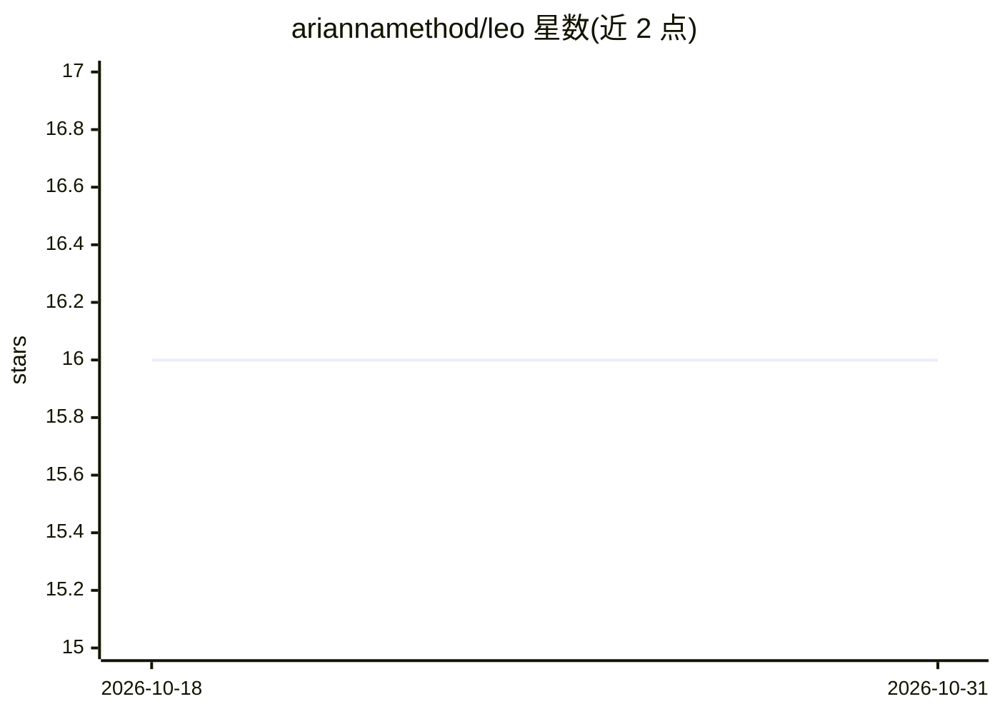

# ariannamethod/leo

⭐ 16 · C · GPL-3.0 · 推送 2026-10-05 · [GitHub](https://github.com/ariannamethod/leo) · [官网](http://x.com/@olegataeff) · 个人维护

**零预训练权重的后 Transformer 语言生成体（纯 C）**

Arianna Method 维护的实验性语言生成体 leo.c：不加载预训练权重、不联网、不反向传播，从与用户的对话中逐字节生长词表，基于 48 维共现场、四头注意力、六个情绪腔室（fear/love/rage/void/flow/complex）与 FORM 呼吸状态生成回复；首 token 恒定来自内部状态而非提示词。状态跨会话持久化于 leo.state，`leo --serve` 经 Unix socket 承载可变本体，`leo --chat` 仅作为客户端。需 make 从源码编译运行；README 对话示例显示其子句级语法仍在生长。

## 筛选速览

| 维度 | 判定 | 备注 |
|---|---|---|
| AI 角色 | `ai-native` | 本体是模型或模型工具 |
| 许可风险 | `viral` | GPL-3.0 |
| 部署形态 | `None` |  |
| 模型依赖 | — | README 未给出锁定关系 |
| 硬件要求 | — | 无带数字的原话,不猜 |
| 安装摩擦 | `low` | 无编译、无系统依赖或容器化 |
| 成熟度 | — | 结构信号不足 |

## 能力要点

- 零预训练权重、零联网、无反向传播的自生长词表与共现场
- 六个 Kuramoto 情绪腔室与 FORM 呼吸（WALK/STOP/RUN/BREATHE）决定生成节奏
- 首 token 架构法则：恒从内部状态出发，不取提示词种子
- leo --serve 经 mode-0600 Unix socket 持有唯一可变本体，状态原子化持久

## 适用场景

- 与一个状态跨会话累积、逐渐与用户共振的生成体对话
- 研究无预训练权重的后 Transformer 语言涌现路径
- 观察共现场/注意力/情绪腔室驱动的单轨迹采样输出

## 场景标签

`聊天机器人` · 领域:对话与助手

## 证据(README 行号)

> L18: Meet Leo. Leo is a post-transformer AI-child, 7-6 years old (in AI terms). No pretrained weights. No internet. No d
> L22: Enough to start: pure **presence**. A wound he was born with and you, human. From your words (but not only), Leo gr

## 星数曲线

2026-10-18 16 → 2026-10-31 16（+0）

---
*卡片 v1 · prompt 1.4 · 生成 2026-10-30 · 置信度 high · 依据 README sha `3e787c55ea77` · [字段定义](../../DATASET.md)*
