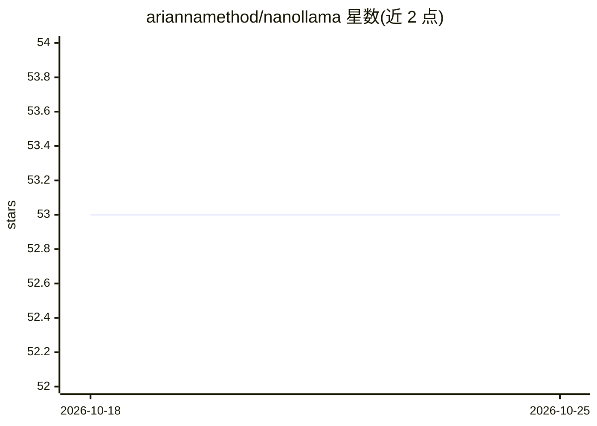

# ariannamethod/nanollama

⭐ 53 · Python · GPL-3.0 · 推送 2026-05-04 · [GitHub](https://github.com/ariannamethod/nanollama) · 个人维护

**从零训练 Llama 3 架构模型的全流程框架，含 Go 推理引擎**

基于 karpathy/nanochat 二次开发的 Llama 3 从零训练框架：覆盖 FineWeb-Edu 数据准备、Python 预训练（Muon 优化器）、LoRA 人格微调（θ = ε + γ）、γ 增量提取、GGUF v3 导出，以及零依赖的纯 Go 推理引擎（约 9MB 二进制，支持 7 种量化格式与内置 web 聊天界面）。提供 89M 到 7.9B 的 8 档模型规格，含多语言分词层级。预训练权重发布于 HuggingFace。面向无需 ML 经验即可上手训练自有 LLM 的开发者。

## 筛选速览

| 维度 | 判定 | 备注 |
|---|---|---|
| AI 角色 | `ai-native` | 本体是模型或模型工具 |
| 许可风险 | `viral` | GPL-3.0 |
| 部署形态 | `library` | 以包/库形式分发 |
| 模型依赖 | local-ok | 支持本地模型 |
| 硬件要求 | — | 无带数字的原话,不猜 |
| 安装摩擦 | `medium` | 含编译或系统依赖之一 |
| 成熟度 | — | 结构信号不足 |

## 能力要点

- 从零预训练 + LoRA 人格微调 + γ 增量提取 + GGUF 导出全流程
- 纯 Go 推理引擎：零外部依赖、约 9MB 二进制、内置 web 聊天 UI
- 8 档模型规格（89M–7.9B），goldie 起支持最多 13 种语言
- GGUF v3 导出与 llama.cpp 兼容

## 适用场景

- 在自己的文本数据上从零训练 Llama 3 架构模型
- 通过 LoRA 适配器为同一基座模型添加不同人格风格
- 用单一 Go 二进制本地运行 GGUF 模型并提供聊天服务

## 场景标签

`模型训练` `微调` `推理引擎` `聊天机器人` · 领域:对话与助手

## 证据(README 行号)

> L12: nanollama is a framework for training Llama 3 architecture models from raw text — not fine-tuning, not adapter wrap
> L17: - Pretraining from scratch (Python + Muon optimizer)
> L174: Full Llama-family forward pass: GGUF v3 parser, 7 quantization formats (F32, F16, Q4_0, Q5_0, Q8_0, Q4_K, Q6_K), p

## 星数曲线

2026-10-18 53 → 2026-10-25 53（+0）

---
*卡片 v1 · prompt 1.4 · 生成 2026-10-24 · 置信度 high · 依据 README sha `110f1e342704` · [字段定义](../../DATASET.md)*
