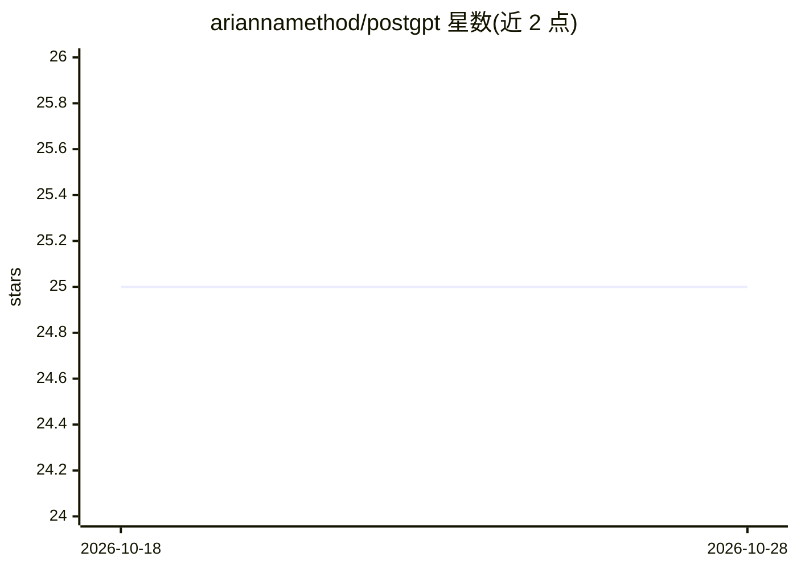

# ariannamethod/postgpt

⭐ 25 · C · GPL-3.0 · 推送 2026-10-04 · [GitHub](https://github.com/ariannamethod/postgpt) · [官网](http://x.com/@olegataeff) · 个人维护

**无需训练的 BPE transformer：从共现统计构造"元权重"生成文本**

Python/C 双实现的约 140K 参数小型 transformer（2 层、4 头，含 Content attention 与 RRPRAM 双注意力）。核心机制：对 150KB 语料做 BPE 分词后计算 unigram/bigram/trigram、Hebbian 共现、prophecy field 等统计量构成"metaweights"概率空间，用其直接初始化 transformer 权重，从而在零梯度训练下续写文本。可选训练循环运行于纯 C 的 notorch（Chuck 优化器），仅需 C 编译器、CPU 即可。面向对训练必要性本身感兴趣的研究/实验者。

## 筛选速览

| 维度 | 判定 | 备注 |
|---|---|---|
| AI 角色 | `ai-native` | 本体是模型或模型工具 |
| 许可风险 | `viral` | GPL-3.0 |
| 部署形态 | `None` |  |
| 模型依赖 | — | README 未给出锁定关系 |
| 硬件要求 | `cpu-ok` | |
| 安装摩擦 | `medium` | 含编译或系统依赖之一 |
| 成熟度 | — | 结构信号不足 |

## 能力要点

- 零训练生成：语料统计（bigram/trigram/Hebbian）直接构成概率空间并初始化权重
- 双注意力：Content attention（语义）+ RRPRAM（位置模式）
- postgpt.py 无第三方依赖；C 版本仅需 gcc -lm
- 可选训练循环基于纯 C 的 notorch 自动微分与 Chuck 优化器

## 适用场景

- 研究"数据即模型"：不训练直接生成连贯文本的可行性
- 在无 GPU、无深度学习框架的 CPU 环境跑小型 transformer
- 学习 BPE、共现统计与注意力机制的极简实现

## 场景标签

 · 领域:机器学习研究/语言模型

## 证据(README 行号)

> L9: Not like, philosophically. Literally. What if you tokenize a corpus with BPE, compute the co-occurrence statistics, 
> L25: |`postgpt.py`|Python|**none**|BPE transformer with metaweights. The complete algorithm.|
> L92:  - **meta mode** — pure metaweight generation. The core discovery. Statistical ghost-model.

## 星数曲线

2026-10-18 25 → 2026-10-28 25（+0）

---
*卡片 v1 · prompt 1.4 · 生成 2026-10-27 · 置信度 high · 依据 README sha `845142b0e8b0` · [字段定义](../../DATASET.md)*
