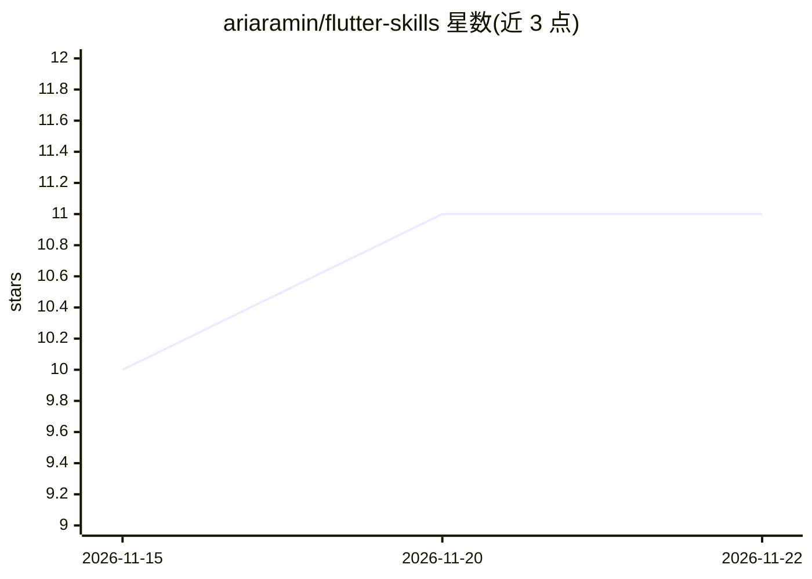

# ariaramin/flutter-skills

⭐ 11 · JavaScript · MIT · 推送 2026-11-06 · [GitHub](https://github.com/ariaramin/flutter-skills) · [官网](https://ariaramin.github.io/flutter-skills/) · 个人维护

**面向 Flutter/Dart 开发的 AI 编程助手技能合集（72 个）**

为 AI 编程助手提供 72 个 Flutter/Dart 技能文件夹，每个含 SKILL.md 清单（触发描述与操作指引）、references/examples/evals 等配套材料，覆盖架构、性能、安全、平台集成与发布。技能不是 Flutter 包，不加入 pubspec.yaml；通过 npx skills、GitHub CLI 或手动复制安装到各 agent 的技能目录，由助手按描述字段决定何时应用。安装依赖 Node.js 22.20+、GitHub CLI 或 git/curl。

## 筛选速览

| 维度 | 判定 | 备注 |
|---|---|---|
| AI 角色 | `ai-knowledge` | 知识聚合/清单类 |
| 许可风险 | `permissive` | MIT |
| 部署形态 | `library` | 以包/库形式分发 |
| 模型依赖 | — | README 未给出锁定关系 |
| 硬件要求 | — | 无带数字的原话,不猜 |
| 安装摩擦 | `low` | 无编译、无系统依赖或容器化 |
| 成熟度 | — | 结构信号不足 |

## 能力要点

- 72 个技能文件夹，SKILL.md 清单驱动触发
- 支持 npx skills / gh skill install / 手动复制多种安装方式
- Cursor、Codex、Copilot、Gemini CLI、OpenCode 共享技能目录
- 部分技能含 evals.json 样例提示与测试材料

## 适用场景

- 给 Claude Code 等编程助手安装 Flutter 架构与性能指引
- 让助手按技能规范处理路由、动效、依赖选型等任务
- 为 Flutter 包/插件发布获取工程化指引

## 场景标签

`编码 Agent` · 领域:编码与开发

## 证据(README 行号)

> L3: A collection of production-focused skills for AI coding assistants working on Flutter and Dart. Each skill is a fold
> L13: The repository contains **72 skill folders** under `skills/`. Every folder has a `SKILL.md` manifest with YAML fron

## 星数曲线

2026-11-15 10 → 2026-11-22 11（+1）

---
*卡片 v1 · prompt 1.4 · 生成 2026-11-20 · 置信度 high · 依据 README sha `5d4ec5ead7e3` · [字段定义](../../DATASET.md)*
