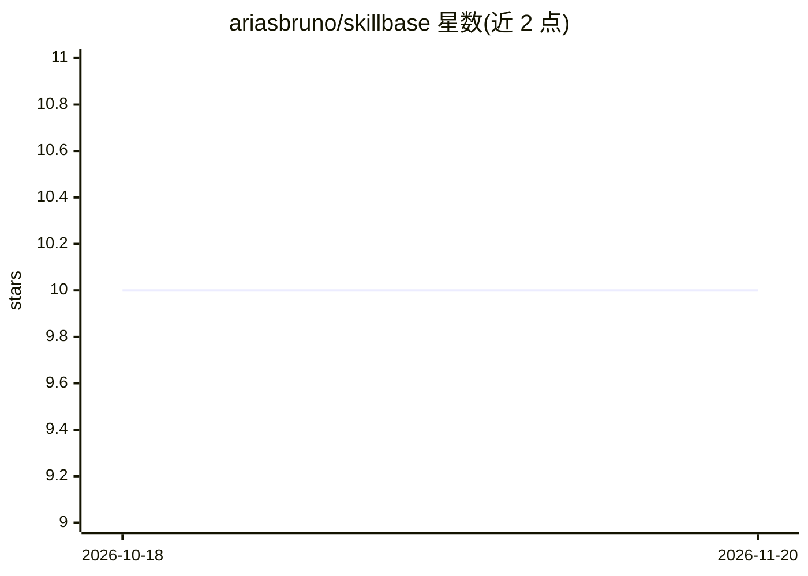

# ariasbruno/skillbase

⭐ 10 · JavaScript · MIT · 推送 2026-04-08 · [GitHub](https://github.com/ariasbruno/skillbase) · [官网](https://www.npmjs.com/package/@ariasbruno/skillbase) · 个人维护

**本地 AI 技能管理器：按工作区链接所需技能**

Node.js CLI，用于在 AI 辅助开发环境中管理 agent 技能：在 ~/.skillbase/skills 维护全局技能注册表，通过符号链接或本地安装为每个工作区只接入所需技能，以减少上下文过载。支持初始化检测项目技术栈并建议技能、交互式选择器、从 skillbase.json 清单重建环境、从 GitHub 远程源安装、检查/更新/迁移，以及通过 SKILLBASE_HOME 环境变量自定义注册表位置。通过 npm 全局安装，支持英文/西班牙文 CLI 语言切换。

## 筛选速览

| 维度 | 判定 | 备注 |
|---|---|---|
| AI 角色 | `ai-ecosystem` | LLM/agent 周边工具 |
| 许可风险 | `permissive` | MIT |
| 部署形态 | `library` | 以包/库形式分发 |
| 模型依赖 | — | README 未给出锁定关系 |
| 硬件要求 | — | 无带数字的原话,不猜 |
| 安装摩擦 | `low` | 无编译、无系统依赖或容器化 |
| 成熟度 | — | 结构信号不足 |

## 能力要点

- 全局注册表 + 符号链接按工作区接入技能，减少上下文体积
- skillbase init 检测项目技术并建议兼容技能
- 支持从 GitHub URL/仓库远程安装技能
- 交互式选择器与 skillbase.json 清单重建环境

## 适用场景

- 前端项目只接入 React/SEO 相关技能，不暴露无关工具
- 不同项目维护各自的技能组合并复用全局注册表
- 从 GitHub 仓库拉取他人发布的技能到本地

## 场景标签

`提示工程` · 领域:Agent 开发

## 证据(README 行号)

> L3: **Local skill manager for AI-assisted development environments.**
> L5: `skillbase` is a Node.js CLI that empowers you to manage skills for your AI agents using symbolic links (symlinks) o
> L23: `skillbase` maintains a **single global registry** on your machine (`~/.skillbase/skills`) and allows you to instal

## 星数曲线

2026-10-18 10 → 2026-11-20 10（+0）

---
*卡片 v1 · prompt 1.4 · 生成 2026-11-20 · 置信度 high · 依据 README sha `2c44084bcb31` · [字段定义](../../DATASET.md)*
