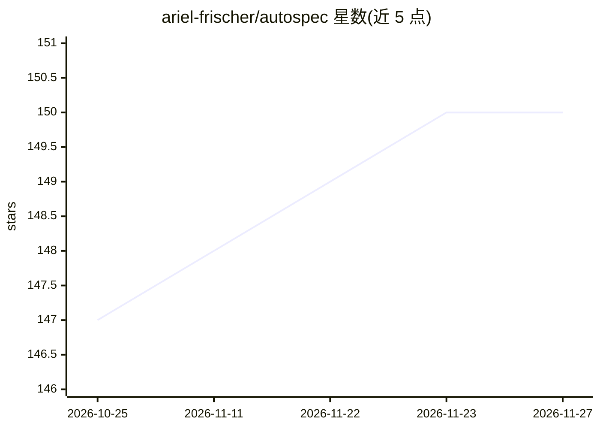

# ariel-frischer/autospec

⭐ 150 · Go · MIT · 推送 2026-11-17 · [GitHub](https://github.com/ariel-frischer/autospec) · [官网](https://ariel-frischer.github.io/autospec/) · 个人维护

**给开发者的 spec→plan→tasks→implement 自动化 CLI**

一个 Go 编写的单二进制 CLI，将规格驱动开发流程（specify → plan → tasks → implement）编排为一条命令：各阶段生成 spec.yaml/plan.yaml/tasks.yaml 等 YAML 工件，进行程序化校验与失败重试，最后由配置的编码 agent 执行任务。要求本机已装 Claude Code/Codex CLI/OpenCode/Jcode 之一及 Git；支持分阶段模型与 profile 配置、会话隔离以控制上下文成本、shell 补全、执行历史、自动 git 提交。通过 install.sh 脚本安装，或需 Go 1.26+ 从源码构建。

## 筛选速览

| 维度 | 判定 | 备注 |
|---|---|---|
| AI 角色 | `ai-ecosystem` | LLM/agent 周边工具 |
| 许可风险 | `permissive` | MIT |
| 部署形态 | `None` |  |
| 模型依赖 | locked-api |  |
| 硬件要求 | — | 无带数字的原话,不猜 |
| 安装摩擦 | `medium` | 含编译或系统依赖之一 |
| 成熟度 | — | 结构信号不足 |

## 能力要点

- 一条命令编排 specify→plan→tasks→implement 四阶段并自动重试
- 生成机器可读的 spec.yaml/plan.yaml/tasks.yaml 并做程序化校验
- 支持 Claude Code、Codex CLI、OpenCode、Jcode 及自定义 agent 命令
- 分阶段/任务级会话隔离与 per-stage 模型、profile 配置

## 适用场景

- 把功能描述一键转成规格、计划、任务分解并自动实现
- 让 agent 实现前先人工审阅并编辑 spec.yaml
- 在 CI/CD 中用标准化退出码集成自动化流程

## 场景标签

`编码 Agent` · 领域:编码与开发

## 证据(README 行号)

> L13: Build features systematically with AI-powered specification workflows.
> L15: **Stop AI slop.** Autospec brings structure to AI coding: spec → plan → tasks → implement - all in one command.
> L20: Supported agents: Claude Code, Codex CLI, OpenCode, and Jcode.

## 星数曲线

2026-10-25 147 → 2026-11-27 150（+3）

---
*卡片 v1 · prompt 1.4 · 生成 2026-11-27 · 置信度 high · 依据 README sha `8e9dd75eb08c` · [字段定义](../../DATASET.md)*
