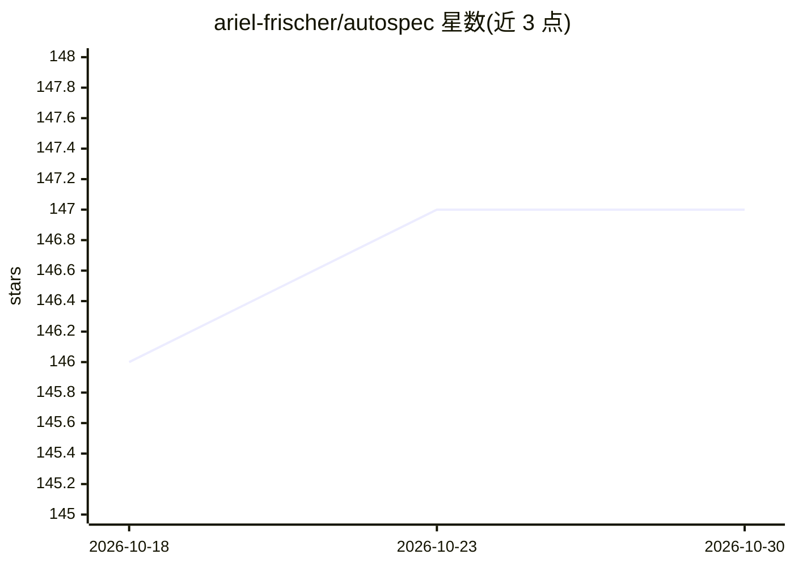

# ariel-frischer/autospec

⭐ 147 · Go · MIT · 推送 2026-09-28 · [GitHub](https://github.com/ariel-frischer/autospec) · [官网](https://ariel-frischer.github.io/autospec/) · 个人维护

**开发者 CLI：自动化 spec→plan→tasks→implement 的规范驱动开发**

Go 编写的单二进制命令行工具，编排 AI 编码代理完成规范驱动开发流程：specify 生成规格、plan 生成设计、tasks 拆解任务、implement 执行，各阶段产出机器可读的 YAML 产物并做程序化校验与依赖顺序重试。支持 Claude Code、Codex CLI、OpenCode、Jcode 及自定义代理，可按阶段选模型与配置 profile。通过 install.sh 脚本安装，提供 Linux/macOS 原生二进制，Windows 需 WSL；也可用 Go 1.25+ 从源码构建。

## 筛选速览

| 维度 | 判定 | 备注 |
|---|---|---|
| AI 角色 | `ai-ecosystem` | LLM/agent 周边工具 |
| 许可风险 | `permissive` | MIT |
| 部署形态 | `None` |  |
| 模型依赖 | — | README 未给出锁定关系 |
| 硬件要求 | — | 无带数字的原话,不猜 |
| 安装摩擦 | `medium` | 含编译或系统依赖之一 |
| 成熟度 | — | 结构信号不足 |

## 能力要点

- 四阶段工作流产出 spec/plan/tasks.yaml 机器可读产物
- 按阶段/任务隔离会话执行以控制上下文与成本
- 支持 Claude Code、Codex CLI、OpenCode、Jcode 与自定义代理
- 自动 git 提交、历史追踪、shell 补全、桌面通知

## 适用场景

- 用一条命令跑完从规格到实现的完整流程
- 在 AI 编码代理上以结构化产物替代长对话实现
- 按阶段选择不同模型并校验产物完整性

## 场景标签

`编码 Agent` · 领域:编码与开发

## 证据(README 行号)

> L15: **Stop AI slop.** Autospec brings structure to AI coding: spec → plan → tasks → implement - all in one command.
> L20: Supported agents: Claude Code, Codex CLI, OpenCode, and Jcode.
> L41: - **Multi-Agent** — Claude Code, Codex CLI, OpenCode, and Jcode, plus custom agent commands

## 星数曲线

2026-10-18 146 → 2026-10-30 147（+1）

---
*卡片 v1 · prompt 1.4 · 生成 2026-10-22 · 置信度 high · 依据 README sha `46e17b47e1ae` · [字段定义](../../DATASET.md)*
