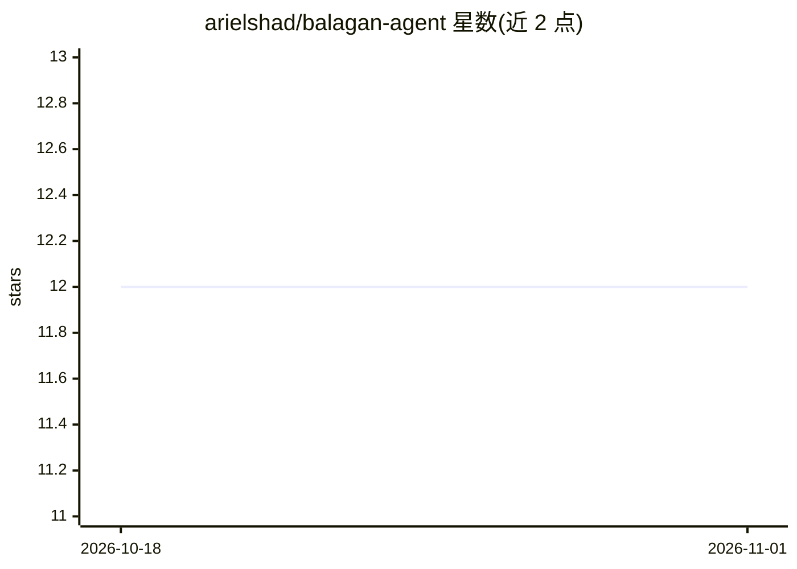

# arielshad/balagan-agent

⭐ 12 · Python · Apache-2.0 · 推送 2026-03-16 · [GitHub](https://github.com/arielshad/balagan-agent) · 个人维护

**对 AI agent 做混沌工程测试的可靠性框架**

Python 可靠性测试框架，通过受控故障注入压测 AI agent：注入工具失败、延迟、幻觉数据、上下文损坏与预算耗尽等故障，计算 MTTR、恢复质量与可靠性评分，输出终端/JSON/Markdown/HTML 报告。面向需要 SLO 合规与可靠性验证的开发团队。提供 CrewAI、AutoGen、LangChain 的 wrapper，chaos_level 参数（0.0-2.0）控制故障概率，场景可用代码或 JSON 定义，带 CLI 与 CI/CD 支持。当前版本 v0.4.0。

## 筛选速览

| 维度 | 判定 | 备注 |
|---|---|---|
| AI 角色 | `ai-ecosystem` | LLM/agent 周边工具 |
| 许可风险 | `permissive` | Apache-2.0 |
| 部署形态 | `library` | 以包/库形式分发 |
| 模型依赖 | — | README 未给出锁定关系 |
| 硬件要求 | — | 无带数字的原话,不猜 |
| 安装摩擦 | `low` | 无编译、无系统依赖或容器化 |
| 成熟度 | — | 结构信号不足 |

## 能力要点

- 5 类故障注入器：工具失败、延迟、幻觉、上下文损坏、预算耗尽
- MTTR、恢复质量、可靠性评分（SRE 级）与错误预算指标
- CrewAI/AutoGen/LangChain 框架 wrapper 与内置 CI/CD 支持
- 多格式报告：终端、JSON、Markdown、HTML

## 适用场景

- 上线前验证 agent 在 API 超时、工具返回异常数据时的表现
- 压测找出 agent 的故障 breaking point
- 量化 agent 的 MTTR 与恢复率以满足 SLO
- 回归测试确认改动未破坏故障处理逻辑

## 场景标签

`模型评测` · 领域:评测与运维

## 证据(README 行号)

> L21: BalaganAgent is a reliability testing framework that stress-tests AI agents through controlled fault injection—beca
> L34: AI agents are entering production environments, but there's zero reliability discipline. BalaganAgent brings the ba

## 星数曲线

2026-10-18 12 → 2026-11-01 12（+0）

---
*卡片 v1 · prompt 1.4 · 生成 2026-11-01 · 置信度 high · 依据 README sha `d03f34c68918` · [字段定义](../../DATASET.md)*
