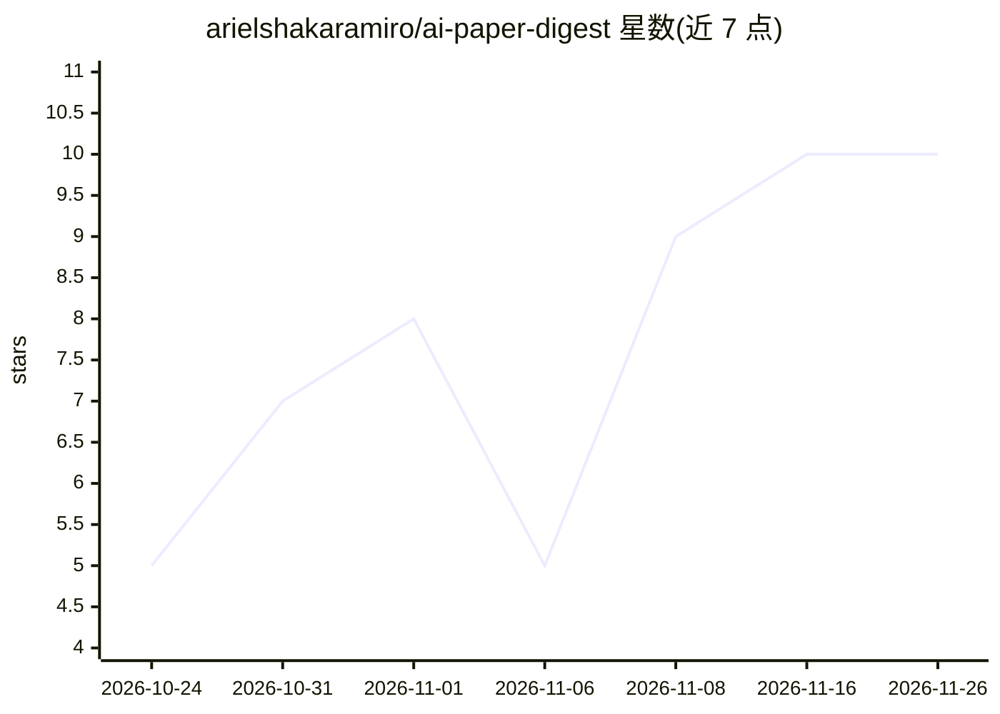

# arielshakaramiro/ai-paper-digest

⭐ 10 · Python · MIT · 推送 2026-11-25 · [GitHub](https://github.com/arielshakaramiro/ai-paper-digest) · 个人维护

**自动抓取 arXiv 论文并每日生成双语 AI 研究摘要**

每日运行一次的 GitHub Actions 流水线：从 arXiv API 拉取 cs.AI/cs.LG/cs.CL/cs.CV 新论文，按 config.json 关键词加权排序，将 top 10 发送到任意 OpenAI 兼容 chat 端点生成英文与印尼语摘要，连同 papers.csv 数据集提交回仓库。无 API key 时回退到摘要前几句，流水线不中断。main.py 仅用标准库，Python 3.9+ 无需 pip install，周末无新论文则不提交。

## 筛选速览

| 维度 | 判定 | 备注 |
|---|---|---|
| AI 角色 | `ai-knowledge` | 知识聚合/清单类 |
| 许可风险 | `permissive` | MIT |
| 部署形态 | `library` | 以包/库形式分发 |
| 模型依赖 | local-ok | 支持本地模型 |
| 硬件要求 | — | 无带数字的原话,不猜 |
| 安装摩擦 | `low` | 无编译、无系统依赖或容器化 |
| 成熟度 | — | 结构信号不足 |

## 能力要点

- GitHub Actions 每日定时运行，自动提交摘要与 CSV 数据集
- 关键词加权排序，标题匹配计双倍分
- 支持任意 OpenAI 兼容 /chat/completions 端点，无 key 时回退到摘要
- 配置化自定义：arXiv 分类、关键词、每期篇数、输出语言

## 适用场景

- 每天自动跟踪 AI/ML 领域 arXiv 新论文
- 积累可分析趋势的论文 CSV 数据集
- 定制关键词权重，聚焦 agents/RAG 等应用方向

## 场景标签

`科研工具` `AI 写作` · 领域:内容生成

## 证据(README 行号)

> L3: A daily, automatically curated digest of new AI/ML research from arXiv. Every morning a GitHub Actions workflow fetc
> L5: The archive grows into a searchable record of what the field is publishing, plus a CSV dataset you can analyze for t

## 星数曲线

2026-10-24 5 → 2026-11-26 10（+5）

---
*卡片 v1 · prompt 1.4 · 生成 2026-11-20 · 置信度 mid · 依据 README sha `e764483b1899` · [字段定义](../../DATASET.md)*
