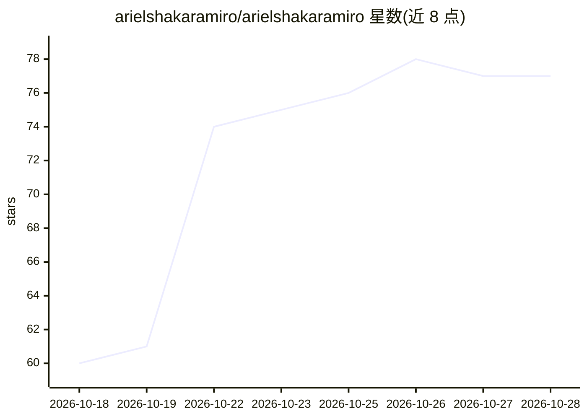

# arielshakaramiro/arielshakaramiro

⭐ 77 · MIT · 推送 2026-10-04 · [GitHub](https://github.com/arielshakaramiro/arielshakaramiro) · 个人维护

**个人技术档案页：AI/ML 工程师技能与求职意向展示**

仓库为 Muhammad Ariel Shakaramiro 的个人简介 README，内容为技能清单罗列：LLM/RAG 相关（LangChain、LangGraph、LlamaIndex、Pinecone、FAISS、Prompt Engineering）、NLP（spaCy、BERT、Word2Vec、TF-IDF）、计算机视觉（OpenCV、YOLO、Faster R-CNN、Tesseract OCR）、深度学习框架（PyTorch、TensorFlow）及部署工具（FastAPI、Docker、Streamlit、云平台）。README 未提供可安装或运行的软件本体，仅作个人履历展示，描述中声明正在寻找全职 AI 工程师岗位。

## 筛选速览

| 维度 | 判定 | 备注 |
|---|---|---|
| AI 角色 | `ai-knowledge` | 知识聚合/清单类 |
| 许可风险 | `permissive` | MIT |
| 部署形态 | `None` |  |
| 模型依赖 | — | README 未给出锁定关系 |
| 硬件要求 | — | 无带数字的原话,不猜 |
| 安装摩擦 | `low` | 无编译、无系统依赖或容器化 |
| 成熟度 | — | 结构信号不足 |

## 能力要点

- 罗列 LLM/RAG 技术栈（LangChain、LangGraph、LlamaIndex、向量库）
- 涵盖 CV（YOLO、Faster R-CNN、OpenCV）与 NLP（BERT、spaCy）技能
- 列出 FastAPI、Docker、云部署等工程化工具

## 适用场景

- 了解该开发者的技能构成与求职意向
- 作为 GitHub 个人主页档案浏览

## 场景标签

 · 领域:个人档案/职业展示

## 证据(README 行号)

> L1: Muhammad Ariel Shakaramiro
> L3:  About Muhammad Ariel Shakaramiro

## 星数曲线

2026-10-18 60 → 2026-10-28 77（+17）

---
*卡片 v1 · prompt 1.4 · 生成 2026-10-24 · 置信度 low · 依据 README sha `666088610feb` · [字段定义](../../DATASET.md)*
