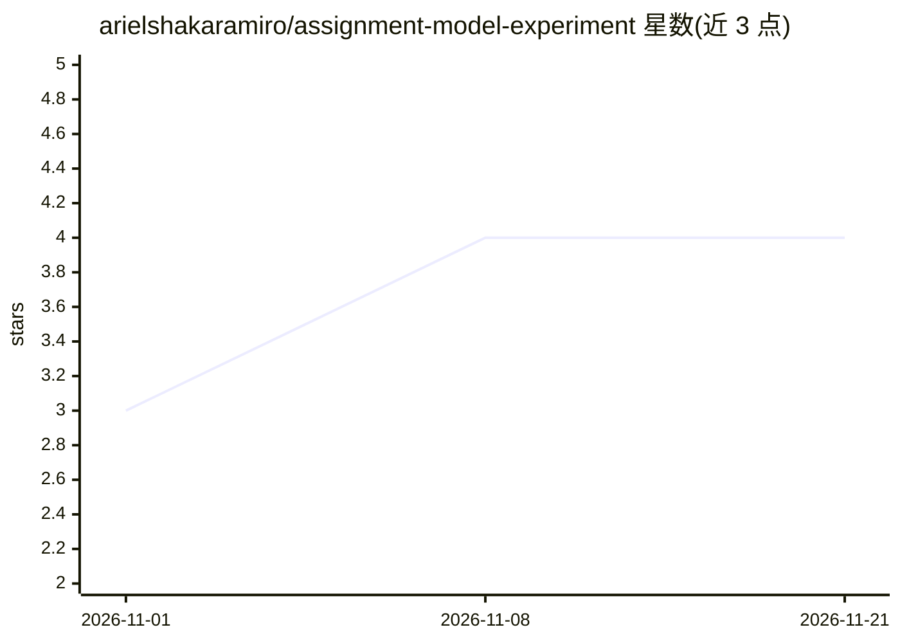

# arielshakaramiro/assignment-model-experiment

⭐ 4 · Jupyter Notebook · 推送 2026-10-22 · [GitHub](https://github.com/arielshakaramiro/assignment-model-experiment) · 个人维护

**印尼电商评论情感分析实验：对比传统ML与Gemini LLM**

一份 AI 工程训练营个人作业的实验报告仓库：对 200 条印尼语电商评论做二分类情感分析，对比 TF-IDF+Logistic Regression 自训模型与 Gemini API 零样本/少样本两条路径。实验覆盖数据泄漏检测（40 个唯一文本导致 98% 测试句重复）、无泄漏分组切分评估、8 条手写鲁棒性测试及延迟/成本核算，最终给出零样本 Gemini 加异步缓存架构并准备蒸馏路径的技术建议。仓库含数据集、结果文件与评估脚本。

## 筛选速览

| 维度 | 判定 | 备注 |
|---|---|---|
| AI 角色 | `ai-knowledge` | 知识聚合/清单类 |
| 许可风险 | `none` | — |
| 部署形态 | `None` |  |
| 模型依赖 | — | README 未给出锁定关系 |
| 硬件要求 | — | 无带数字的原话,不猜 |
| 安装摩擦 | `low` | 无编译、无系统依赖或容器化 |
| 成熟度 | — | 结构信号不足 |

## 能力要点

- 检测并量化数据泄漏：98% 测试句存在于训练集
- 无泄漏评估方案：GroupShuffleSplit + GroupKFold 交叉验证
- 8 条手写难例鲁棒性测试（否定、讽刺、混情感、英文）
- 延迟与成本核算，含 Gemini API 真实调用记录与缓存

## 适用场景

- 复现传统 ML 与 LLM API 在情感分析上的对比实验
- 学习数据泄漏检测与无泄漏评估的设计方法
- 评估 LLM API 方案的延迟与成本是否适合评论分类场景

## 场景标签

`模型评测` · 领域:评测与运维

## 证据(README 行号)

> L4: Individual Assignment, AI Engineering Bootcamp · Muhammad Ariel Shakaramiro
> L12: **Objective.** An e-commerce product team wants an automated feature that classifies the sentiment of customer revi

## 星数曲线

2026-11-01 3 → 2026-11-21 4（+1）

---
*卡片 v1 · prompt 1.4 · 生成 2026-11-21 · 置信度 mid · 依据 README sha `394a9119941b` · [字段定义](../../DATASET.md)*
