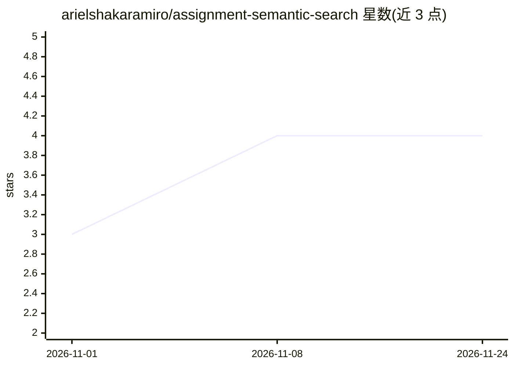

# arielshakaramiro/assignment-semantic-search

⭐ 4 · Jupyter Notebook · 推送 2026-10-22 · [GitHub](https://github.com/arielshakaramiro/assignment-semantic-search) · 个人维护

**电商客服 FAQ 语义检索+LLM 问答原型（印尼语）**

面向电商客服团队的 RAG 原型：以 59 条印尼语 FAQ 为知识库，用 Pandas 摄取、Gemini Embeddings 生成向量、FAISS IndexFlatIP 存储，检索 top-3 后经结构化提示（Persona/Task/Context/Format）由 gemini-flash-latest 生成仅基于 FAQ 的回答，答案末尾引用 FAQ 编号以保证可溯源；知识库外问题则按提示规则拒答并转人工。限制包括无相关性阈值、未做重排序/混合检索、知识库静态需重新嵌入、单轮无记忆。README 含 8 条查询的测试结果与逐项分析。

## 筛选速览

| 维度 | 判定 | 备注 |
|---|---|---|
| AI 角色 | `ai-native` | 本体是模型或模型工具 |
| 许可风险 | `none` | — |
| 部署形态 | `None` |  |
| 模型依赖 | — | README 未给出锁定关系 |
| 硬件要求 | — | 无带数字的原话,不猜 |
| 安装摩擦 | `low` | 无编译、无系统依赖或容器化 |
| 成熟度 | `idea` | |

## 能力要点

- Gemini Embeddings 非对称检索（RETRIEVAL_DOCUMENT/QUERY 分离 task_type）
- FAISS IndexFlatIP + L2 归一化实现余弦相似度检索
- 结构化提示强制只基于 Context 作答并引用 FAQ 来源
- README 附 8 条查询测试：Hit@1/Hit@3 均为 100%

## 适用场景

- 客服机器人按官方 FAQ 语义匹配用户口语化提问
- 知识库外问题自动拒答并转人工
- 作为 RAG 系统搭建的教学/作业原型

## 场景标签

`RAG` · 领域:知识与检索

## 证据(README 行号)

> L3: A customer service assistant prototype that retrieves the most relevant FAQ entries **semantically** (by meaning, no
> L5: **Stack:** Python · Pandas · Gemini Embeddings API · FAISS · Gemini API

## 星数曲线

2026-11-01 3 → 2026-11-24 4（+1）

---
*卡片 v1 · prompt 1.4 · 生成 2026-11-21 · 置信度 high · 依据 README sha `d2c94ac4523c` · [字段定义](../../DATASET.md)*
