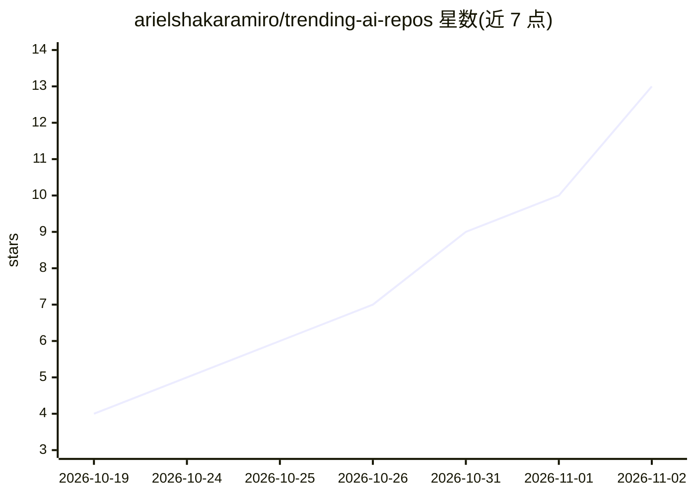

# arielshakaramiro/trending-ai-repos

⭐ 13 · Python · MIT · 推送 2026-11-01 · [GitHub](https://github.com/arielshakaramiro/trending-ai-repos) · 个人维护

**每日追踪 GitHub 上 AI 仓库趋势并输出周报的数据仓库**

由 GitHub Actions 每日自动运行的追踪器：读取 GitHub 趋势页，通过 GitHub REST API 获取仓库的 topics、许可证与创建时间，按 AI 主题或关键词分类后追加到 CSV；每周生成含图表的周报，统计语言占比、主题涨跌与持续上榜仓库。趋势页无法解析时回退到官方 Search API。本地运行需 pip 安装依赖并执行 tracker.py，部署到 GitHub 无需额外 secrets。

## 筛选速览

| 维度 | 判定 | 备注 |
|---|---|---|
| AI 角色 | `ai-knowledge` | 知识聚合/清单类 |
| 许可风险 | `permissive` | MIT |
| 部署形态 | `library` | 以包/库形式分发 |
| 模型依赖 | — | README 未给出锁定关系 |
| 硬件要求 | — | 无带数字的原话,不猜 |
| 安装摩擦 | `low` | 无编译、无系统依赖或容器化 |
| 成熟度 | — | 结构信号不足 |

## 能力要点

- 每日读取 GitHub 趋势页并按 AI 主题/关键词分类，落盘 CSV
- 每周自动生成含图表的报告：语言分布、主题 movers、持续上榜仓库
- 趋势页失效时回退官方 Search API，保证每日数据不为空
- 提供 config.json 自定义 AI 判定标准与追踪范围

## 适用场景

- 查看今日/本周 GitHub 上趋势 AI 仓库与语言、主题变化
- 用 pandas 直接读取 CSV 做自定义分析
- fork 后自建一个每日自动更新的 AI 趋势追踪仓库

## 场景标签

`网页抓取` `数据分析` · 领域:效率与自动化

## 证据(README 行号)

> L3: A daily record of which AI repositories are trending on GitHub, with a weekly analysis of **which topics are rising*
> L5: Every morning a GitHub Actions workflow reads the GitHub trending page, looks up each repository's topics, flags the
> L102: 3. **Classify.** A repo counts as AI if it carries an AI topic (`llm`, `ai-agents`, `rag`, `mcp`, `computer-vision

## 星数曲线

2026-10-19 4 → 2026-11-02 13（+9）

---
*卡片 v1 · prompt 1.4 · 生成 2026-11-02 · 置信度 mid · 依据 README sha `285ae4d65902` · [字段定义](../../DATASET.md)*
