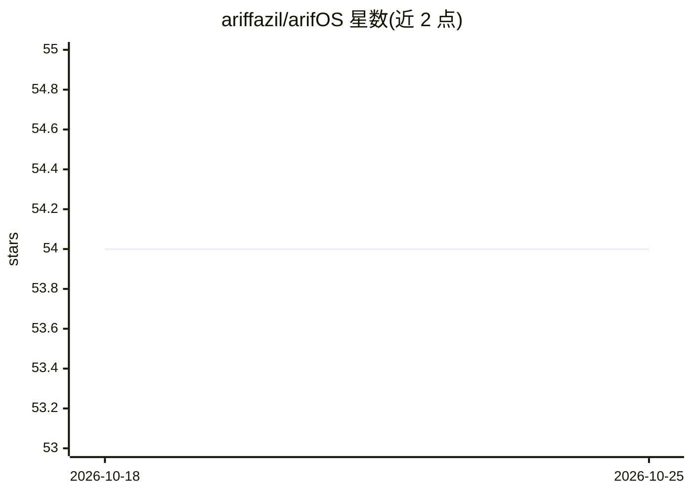

# ariffazil/arifOS

⭐ 54 · Python · AGPL-3.0 · 推送 2026-10-24 · [GitHub](https://github.com/ariffazil/arifOS) · [官网](https://arifos.arif-fazil.com) · 个人维护

**AI 代理执行前的独立治理层：先裁决后执行**

面向 AI agent 的模型无关权威/治理平面：agent 提出行动提案，arifOS 依据 F1–F13 十三条宪法底线（含人类否决、可逆优先、审计可归因等）在执行前给出裁决，输出 VOID/HOLD/SEAL 等七级非补偿性裁决，并将结果写入哈希链式追加账本 VAULT999 形成审计回执。执行本身由外部组件 A-FORGE 完成，裁判不执行。以 pip 包提供，支持 MCP 接入（公共端点或自托管 :8088）。README 明确列出未证明项：独立审计未发布、人类签名未密码学绑定、账本无外部锚定、无第三方评测与生产客户。

## 筛选速览

| 维度 | 判定 | 备注 |
|---|---|---|
| AI 角色 | `ai-ecosystem` | LLM/agent 周边工具 |
| 许可风险 | `viral` | AGPL-3.0 |
| 部署形态 | `library` | 以包/库形式分发 |
| 模型依赖 | — | README 未给出锁定关系 |
| 硬件要求 | — | 无带数字的原话,不猜 |
| 安装摩擦 | `low` | 无编译、无系统依赖或容器化 |
| 成熟度 | `idea` | |

## 能力要点

- F1–F13 十三条宪法底线，任一失败即传播至裁决，不做加权平均
- 七级有序裁决格（VOID > HOLD_888 > HOLD > SABAR > PARTIAL > PROVISIONAL > SEAL）
- VAULT999 哈希链式追加账本记录裁决与回执（自可验证，非独立可公证）
- 确定性拒绝路径不咨询 LLM（gate: hard_deterministic, llm_consulted: false）

## 适用场景

- 企业在 agent 执行敏感操作（如删除账户、大额退款）前插入裁决门与人工否决
- 为 MCP 客户端（Cline/Cursor/Claude Desktop 等）接入统一的策略治理端点
- 留存可审计的 agent 决策记录与回执以满足合规要求

## 场景标签

 · 领域:AI 治理/agent 基础设施

## 证据(README 行号)

> L21: **arifOS is a model-independent authority plane for AI agents.** It evaluates consequential proposals against thirt
> L43: |**Agent / A2A**|MCP tools + receipts. You do not get the keys. Judgment by arifOS, discovery by AAA, execution by 
> L38: **What arifOS is not:** not an AI model · not an agent framework · not an execution engine (A-FORGE executes) · not

## 星数曲线

2026-10-18 54 → 2026-10-25 54（+0）

---
*卡片 v1 · prompt 1.4 · 生成 2026-10-24 · 置信度 high · 依据 README sha `5eec70528a60` · [字段定义](../../DATASET.md)*
