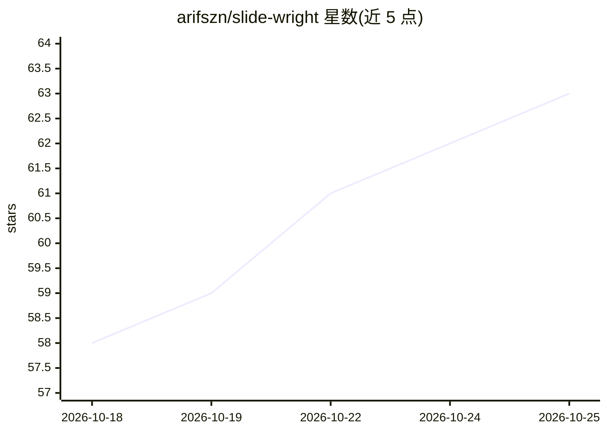

# arifszn/slide-wright

⭐ 64 · JavaScript · MIT · 推送 2026-10-24 · [GitHub](https://github.com/arifszn/slide-wright) · 个人维护

**让编程 agent 生成幻灯片的技能：预览确认后构建并导出**

以 SKILL.md 格式分发的 agent 技能，安装到 Claude Code（插件市场）、Codex、Gemini CLI、Cursor 等编程 agent 后，用户以 /slide-wright 命令描述主题或提纲，agent 先生成配色与字体的主题及 2 页预览，用户确认后构建完整演示文稿，可导出 PowerPoint（文字为可编辑文本框、形状图表烘焙为背景）或 PDF，也可部署为单文件 HTML 到静态主机。手动导出需 Node 18+ 与 Chrome。

## 筛选速览

| 维度 | 判定 | 备注 |
|---|---|---|
| AI 角色 | `ai-ecosystem` | LLM/agent 周边工具 |
| 许可风险 | `permissive` | MIT |
| 部署形态 | `library` | 以包/库形式分发 |
| 模型依赖 | — | README 未给出锁定关系 |
| 硬件要求 | — | 无带数字的原话,不猜 |
| 安装摩擦 | `low` | 无编译、无系统依赖或容器化 |
| 成熟度 | — | 结构信号不足 |

## 能力要点

- 两页预览→确认→构建完整 deck 的流程
- 导出 PowerPoint/PDF，或部署为自包含单文件 HTML
- 兼容任意支持 SKILL.md 格式的编程 agent，可通过 npx skills 安装
- 演示内置键盘快捷键（全屏/演讲者视图/总览）

## 适用场景

- 用编程 agent 从主题或提纲生成可导出的演示文稿
- 先看两页风格预览再决定是否生成整套幻灯片
- 把生成的 deck 部署到静态主机获得跨设备可访问的链接

## 场景标签

 · 领域:开发者工具/演示生成

## 证据(README 行号)

> L47: ### Other agents (Codex, OpenCode, Antigravity, Gemini, Cursor, …)
> L49: slide-wright is a standalone skill that works in any agent supporting the `SKILL.md` format. See **INSTALL.md** for

## 星数曲线

2026-10-18 58 → 2026-10-25 63（+5）

---
*卡片 v1 · prompt 1.4 · 生成 2026-10-24 · 置信度 high · 依据 README sha `1361cfc96d22` · [字段定义](../../DATASET.md)*
