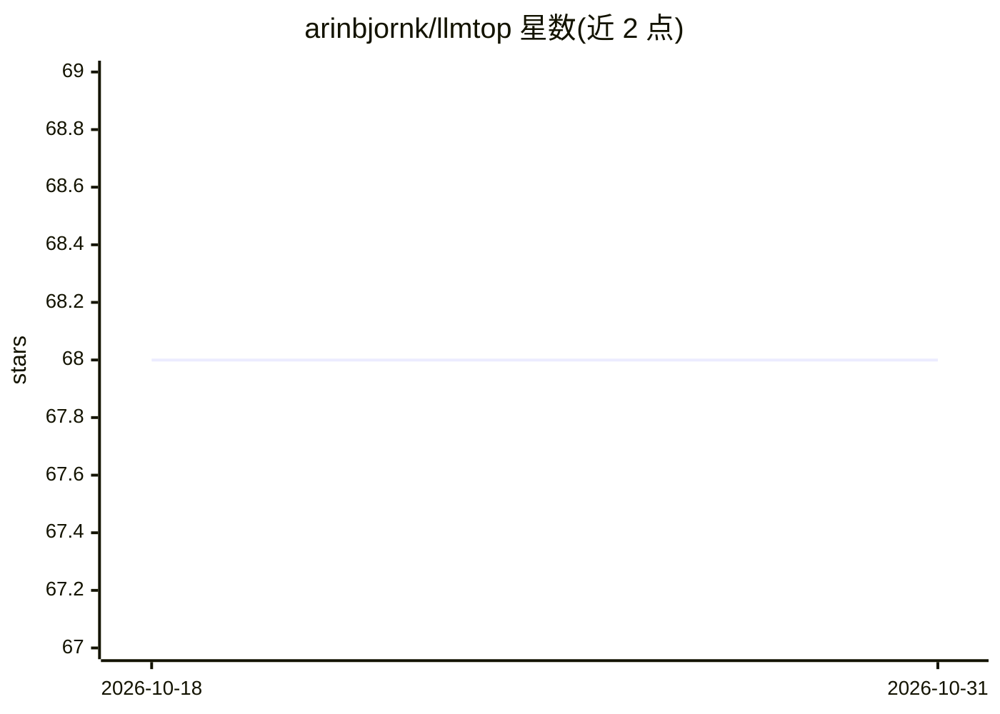

# arinbjornk/llmtop

⭐ 68 · Python · MIT · 推送 2025-12-23 · [GitHub](https://github.com/arinbjornk/llmtop) · 个人维护

**LLM 驱动的终端系统监控工具：实时指标+AI 分析**

在终端实时展示 CPU、内存、磁盘、网络与进程资源占用的监控工具，叠加 LLM 生成的系统分析：可用 OpenAI（GPT-4o mini，需 API key）或本地 Ollama（Llama 3.2 3B，默认后端）进行分析，并带资源阈值智能告警与自动刷新的终端 UI。基于 Rich 与 psutil 构建，pip 安装即用。项目自述处于 beta 阶段，Windows 支持为实验性（未经测试）。

## 筛选速览

| 维度 | 判定 | 备注 |
|---|---|---|
| AI 角色 | `ai-native` | 本体是模型或模型工具 |
| 许可风险 | `permissive` | MIT |
| 部署形态 | `library` | 以包/库形式分发 |
| 模型依赖 | local-ok | 支持本地模型 |
| 硬件要求 | — | 无带数字的原话,不猜 |
| 安装摩擦 | `low` | 无编译、无系统依赖或容器化 |
| 成熟度 | `idea` | |

## 能力要点

- 实时监控 CPU/内存/磁盘/网络与进程资源占用
- LLM 系统分析：OpenAI（GPT-4o mini）或本地 Ollama（Llama 3.2 3B，默认）
- 资源阈值智能告警与自动刷新的动态终端 UI

## 适用场景

- 在终端监控本机资源并获取 AI 生成的性能分析
- 用本地 Ollama 免费获得系统状态解读
- 资源超阈值时接收智能告警提示

## 场景标签

 · 领域:系统监控/终端工具

## 证据(README 行号)

> L3: `llmtop` is an intelligent system monitoring tool that combines real-time system metrics with LLM-powered insights. 
> L13: - AI-powered system analysis using either OpenAI or Ollama

## 星数曲线

2026-10-18 68 → 2026-10-31 68（+0）

---
*卡片 v1 · prompt 1.4 · 生成 2026-10-24 · 置信度 high · 依据 README sha `e8b5b5d1ad1f` · [字段定义](../../DATASET.md)*
