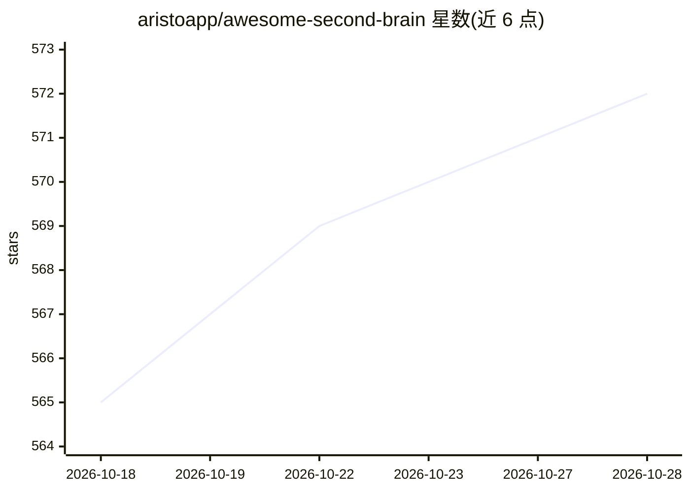

# aristoapp/awesome-second-brain

⭐ 573 · Apache-2.0 · 推送 2026-07-13 · [GitHub](https://github.com/aristoapp/awesome-second-brain) · [官网](https://membase.so/gh) · 组织维护

**AI 第二大脑方案对比清单：按生命周期选型知识系统**

一份策展式对比清单，收录端到端应用、本地工作区、agent 记忆层、记忆基座与平台基线五类共 20 余个第二大脑/记忆/知识系统。以 Collect-Organize-Evolve-Use-Govern 五阶段生命周期为框架，给出按缺口选型的对照表、能力矩阵、激活证据与本地/云等深度页面，并声明核心结论须有官方文档或本地实测支撑，指向官方安装文档而不复制步骤。面向想让 AI 理解个人/团队上下文的用户与开发者。

## 筛选速览

| 维度 | 判定 | 备注 |
|---|---|---|
| AI 角色 | `ai-knowledge` | 知识聚合/清单类 |
| 许可风险 | `permissive` | Apache-2.0 |
| 部署形态 | `library` | 以包/库形式分发 |
| 模型依赖 | — | README 未给出锁定关系 |
| 硬件要求 | — | 无带数字的原话,不猜 |
| 安装摩擦 | `low` | 无编译、无系统依赖或容器化 |
| 成熟度 | — | 结构信号不足 |

## 能力要点

- 五阶段生命周期框架（Collect/Organize/Evolve/Use/Govern）组织选型
- 覆盖 20+ 系统的分组对比表（适用场景与权衡）
- 深度页面含能力矩阵、激活证据、设置负担、本地 vs 云等维度
- 贡献规范要求一手来源或标注 Unknown

## 适用场景

- 我在搭建个人第二大脑前比较各方案的覆盖范围与权衡
- 我按自己卡住的生命周期阶段（如收集/治理）找到起点方案
- 我需要评估 agent 记忆层与记忆基座类基础设施的差异

## 场景标签

`精选清单` · 领域:学习与行业

## 证据(README 行号)

> L17: A curated comparison of second brain, AI memory, and knowledge systems for people who want AI to understand their p
> L45: This snapshot compares each system by the lifecycle stages where it is strongest, grouped by the kind of system you

## 星数曲线

2026-10-18 565 → 2026-10-28 572（+7）

---
*卡片 v1 · prompt 1.4 · 生成 2026-10-21 · 置信度 mid · 依据 README sha `7fbe5aab81a0` · [字段定义](../../DATASET.md)*
