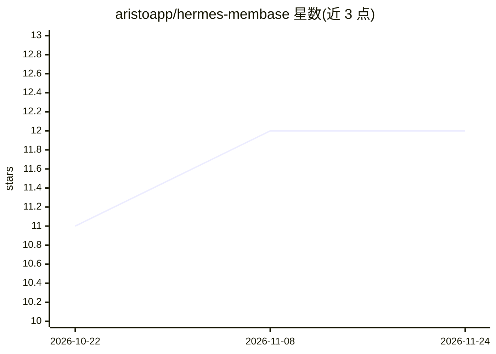

# aristoapp/hermes-membase

⭐ 12 · Python · MIT · 推送 2026-07-03 · [GitHub](https://github.com/aristoapp/hermes-membase) · [官网](https://docs.membase.so/connectors/hermes) · 组织维护

**为 Hermes Agent 提供跨会话持久记忆的插件**

Membase 官方 Hermes 插件，为 Hermes Agent 提供跨会话的长期记忆：通过混合向量检索与知识图谱存取实体、关系与事实。安装命令一键完成插件复制、配置写入与 OAuth 登录；每次会话自动执行记忆召回、对话转录采集，并将 Hermes 内置 MEMORY.md 写入镜像到 Membase。提供 9 个 agent 自主调用工具（搜索/存储/遗忘/wiki 增删改查）与 CLI 命令。依赖 Membase 云服务账号，需 Python 3.11+。

## 筛选速览

| 维度 | 判定 | 备注 |
|---|---|---|
| AI 角色 | `ai-ecosystem` | LLM/agent 周边工具 |
| 许可风险 | `permissive` | MIT |
| 部署形态 | `library` | 以包/库形式分发 |
| 模型依赖 | — | README 未给出锁定关系 |
| 硬件要求 | — | 无带数字的原话,不猜 |
| 安装摩擦 | `low` | 无编译、无系统依赖或容器化 |
| 成熟度 | — | 结构信号不足 |

## 能力要点

- 混合向量检索 + 知识图谱存储实体、关系与事实
- 9 个 agent 自主调用工具与 OAuth PKCE 免密钥认证
- Auto-Recall/Auto-Capture 自动注入与转录采集，内置镜像防重复
- 一键安装命令完成插件部署、配置与登录

## 适用场景

- 让 Hermes Agent 记住我的偏好、目标与决策并在下次会话召回
- 把对话中的重要信息沉淀为可检索的 wiki 文档
- 需要按日期和来源过滤检索历史记忆

## 场景标签

`Agent 记忆` · 领域:Agent 开发

## 证据(README 行号)

> L15: Give your Hermes Agent persistent memory that survives across sessions. Membase uses hybrid vector search and a kno
> L30: 1. Copies the self-contained plugin into `~/.hermes/plugins/membase/`
> L67: |`membase_search`|Search memories by semantic similarity. Supports date filtering (`date_from`, `date_to`, `timezon

## 星数曲线

2026-10-22 11 → 2026-11-24 12（+1）

---
*卡片 v1 · prompt 1.4 · 生成 2026-11-18 · 置信度 high · 依据 README sha `cde57adcb06d` · [字段定义](../../DATASET.md)*
